# The Go Programming Language Illium

Go is an open source programming language that makes it easy to build simple,
reliable, and efficient software.

This fork is a personal Go branch maintained by 404Setup.

## Features

> This fork does not modify language syntax or break existing standard library APIs.

### Compiler, Runtime & Memory
- **`cmd/compile` & `-ldflags`**:
  - `-ldflags="-o2"`: bounded loop unrolling and post-SCCP/prove dead branch elimination.
  - `-ldflags="-o3"`: `-o2` plus cost-based inlining, loop interchange and $32 \times 32$ tiling, cross-loop BCE, and two-stage reflection/interface DCE.
  - `-ldflags="-fmth"`: fast-math SSA reductions, reciprocal division, FMA contraction, polynomial math approximations, and `FTZ`/`DAZ` mode (may relax strict IEEE 754 semantics).
  - Use `all=` (e.g., `-ldflags="all=-o3"`) to apply flags across all dependencies.
  - Stack small-buffer optimization (SBO) for non-escaping slices/strings, static constant lowering, and `//go:immutable` compile-time mutation checks.
- **`runtime`**: faster span reclamation, GC sweep, bit-scanning, stack/page/mcache management, write-barrier deduplication, read-only slice spans (`mprotect`/`sigpanic`), and immutable map guards.
- **`slices`, `maps`, `//go:immutable`**: compile-time and runtime immutability for native `[]E` and `map[K]V` values (`ToImmutable`, `IsImmutable`; clones mutable inputs, zero-alloc no-op when already immutable).

### Standard Library
- **`sync/v2`, `sync/v2/container`, `sync/atomic/v2`**: generic `Pool[T]`, `Map[K, V]`, unboxed `atomic/v2.Value[T]`, and ordered/sorted maps (`OrderedMap`, `ConcurrentSkipListMap`, `LinkedHashMap`, `TreeMap`) with zero-alloc CAS/CAD equality and lock-free `ConcurrentSkipListMap.First`.
- **`encoding/base64`**: 2× unrolled AVX2/SSSE3 (`amd64`), ARM64 NEON, and runtime SVE2 vector codecs, AVX2 CR/LF newline stripping, `4×256` `uint32` LUT4 scalar decode, and single-alloc `EncodeToString`.
- **`encoding/json`, `encoding/json/v2`**: compiled marshal/unmarshal fast paths, SWAR scanning/validation, pooled buffers, exact float paths, and generic `*Of` / `Append*` APIs for both `jsonv2` and `GOEXPERIMENT=nojsonv2`.
- **`encoding/xml`**: compiled struct plans (`sync/v2.Map`), pooled codecs, AVX2/SWAR scanning and `EscapeText`, leaf text fast paths, pre-filtered `autoClose`, and deferred attribute/numeric parsing.
- **`fmt`, `internal/fmtsort`, `io`**: stack-buffered formatting and scanning fast paths, interface-skip guards, specialized `fmtsort` comparators, $O(N)$ recursive `Scanner` reuse, and pooled/exact-sized `io.ReadAll`.
- **`net`, `net/http`, `net/http/server`, `net/textproto`, `net/url`**: TTL-aware DNS cache (`GODEBUG=netdnscache=0`), lock-free zone snapshots, HTTP/1.1/2/3 throughput and allocation optimizations, plus the `net/http/server` router with path parameters, route groups, pooled contexts, and middleware.
- **`reflect`**: fast paths for `Equal`, `DeepEqual`, `Comparable`, `Call`, `Select`, `MapKeys`, and `VisibleFields`.

---

## Benchmarks

All benchmarks below were executed on `linux/amd64` (Intel Xeon) comparing upstream Go (or pre-optimization baseline) against Illium (`-cpu=2` where applicable).

### 1. Compiler, Runtime & Reflection

| Category | Benchmark | Baseline | Illium | Speedup / Notes |
| :--- | :--- | ---: | ---: | :--- |
| Compiler (`-o3`) | `LoopInterchange` ($512 \times 512$) | 1,974 µs/op | **295.2 µs/op** | **-85.1%** (6.69×) |
| Compiler (`-o3`) | `CostBasedInlining` | 163.8 ns/op | **25.57 ns/op** | **-84.4%** (6.41×) |
| Compiler (`-o2`) | `LoopUnrollFull` (8-trip) | 6.31 ns/op | **1.59 ns/op** | **-74.8%** (3.97×) |
| Compiler (`-o3`) | `LoopTiling` ($512 \times 512$, $32 \times 32$) | 1,340 µs/op | **767.1 µs/op** | **-42.8%** (1.75×) |
| Compiler (`-fmth`) | `math.Pow` / `ReciprocalDiv` (3×) | 43.17 / 4.11 ns/op | **17.04 / 1.95 ns/op** | **-60.5% / -52.6%** (2.53× / 2.11×) |
| Binary Size | Service + Reflect + Crypto (`-o3`) | 8.59 MB | **5.29 MB** | **-38.4%** (-27.1% on ~300k LOC) |
| Binary Size | `crypto/sha256` (`GOFIPS140=off`) | 2.40 MB | **2.11 MB** | **-12.0%** |
| Stack SBO | `make([]byte, n)` (128 B) / `[]byte(s)` (48 B) | 37.86 / 22.53 ns/op | **3.71 / 1.88 ns/op** | **-90.2% / -91.7%** (1 → **0 allocs**) |
| Stack SBO | `make([]*byte, n)` (64 B) / `make([]int, n)` (128 B) | 23.60 / 38.06 ns/op | **1.84 / 3.71 ns/op** | **-92.2% / -90.3%** (1 → **0 allocs**) |
| Runtime GC | `GCSpanSetResetEmpty` / `GCWbBufFlushDedup` | 3,424 / 1,708 ns/op | **468.7 / 656.8 ns/op** | **-86.3% / -61.5%** (7.31× / 2.60×) |
| Runtime Alloc | `PageCacheFlush64` / `StackCacheClearEmpty` | 1,536 / 72.59 ns/op | **263.7 / 11.89 ns/op** | **-82.8% / -83.6%** (5.82× / 6.11×) |
| Runtime Barrier | `BulkBarrierBitmapSparseClear` / `SparseNil` | 424.2 / 961.0 ns/op | **108.0 / 543.1 ns/op** | **-74.5% / -43.5%** (3.93× / 1.77×) |
| `reflect` | `Comparable` (struct) / `Equal/RegularMemory` | 170.8 / 54.53 ns/op | **16.36 / 6.28 ns/op** | **-90.4% / -88.5%** (7/0 → **0 allocs**) |
| `reflect` | `VisibleFields/Flat` / `MapsDeepEqual` | 727.3 / 340.9 ns/op | **223.2 / 141.6 ns/op** | **-69.3% / -58.5%** (11/6 → **2/0 allocs**) |
| `reflect` | `DeepEqual/[]int` / `CallSerial/Variadic` | 82.79 / 328.0 ns/op | **31.70 / 229.8 ns/op** | **-61.7% / -29.9%** (2.61× / 1.43×) |

#### Immutable Collections (`//go:immutable`, `slices.ToImmutable`, `maps.ToImmutable`)

```go
//go:immutable
var allowed = []string{"read", "write"}

frozenSlice := slices.ToImmutable([]int64{1, 2, 3})
frozenMap := maps.ToImmutable(map[string]int{"ok": 200})
```

- **Read/lookup parity**: `ImmutableSliceRead` (1,024 × `int64`) **2,170 vs 2,216 ns/op**; `ImmutableMapLookup` (256 `string` keys) **4,276 vs 4,199 ns/op** (0 allocs).
- **Idempotent no-op**: `ToImmutableSliceIdempotent` **10.41 ns/op** (0 allocs); `ToImmutableMapIdempotent` **4.13 ns/op** (0 allocs).
- **Freeze cost**: `ToImmutableSlice` (1,024 × `int64`) **39.77 µs/op** (1 alloc, `mprotect` span); `ToImmutableMap` (256 entries) **6.41 µs/op** (4 allocs).

---

### 2. Concurrency & Containers (`sync/v2`, `sync/v2/container`, `sync/atomic/v2`)

| Benchmark | `v1` (`sync` / `atomic`) | `v2` (`sync/v2` / `atomic/v2`) | Delta | Allocs (`v1` → `v2`) |
| :--- | ---: | ---: | ---: | :---: |
| `MapLoadMostlyHits` / `MapMixed` | 12.14 / 52.23 ns/op | **7.11 / 38.81 ns/op** | **-41.4% / -25.7%** | 0/6 B → 0/**4 B** |
| `PoolValue` (32B struct) | 25.90 ns/op | **6.23 ns/op** | **-76.0%** (4.16×) | 1 (32 B) → **0 (0 B)** |
| `atomic.Value` `Load` / `Store` / `Swap` (`int`) | 1.03 / 17.18 / 18.31 ns/op | **0.35 / 5.77 / 7.55 ns/op** | **-66.0% / -66.4% / -58.8%** | 0/7 B/7 B → **0 B** |
| `atomic.Value` `CAS Mismatch` (128B) | 69.03 ns/op | **9.79 ns/op** | **-85.8%** (7.05×) | 1 (128 B) → **0 (0 B)** |

- **Ordered/sorted containers** (1,024 entries — `Load` / `Store` / `Churn`): `LinkedHashMap` **10.79 / 11.88 / 66.99 ns/op**; `OrderedMap` **21.00 / 47.61 / 252.73 ns/op** (parallel hit load **9.04 ns/op**, 0 allocs); `TreeMap` **53.28 / 51.49 / 281.83 ns/op**; `ConcurrentSkipListMap` **85.54 / 120.03 / 319.97 ns/op** (`First` parallel **2.01 ns/op**, 0 allocs). Zero-alloc `CompareAndSwapMiss` (16B struct): **13.86–40.26 ns/op**.

---

### 3. Networking & HTTP (`net`, `net/http`, `net/http/server`)

```mermaid
xychart-beta
    title "net/http: Go 1.27.3 (left) vs Illium (right) — Latency (ns/op, lower is better)"
    x-axis ["ReadRequest (Wrk)", "ServerMatch", "ReadRequest (Chrome)", "ReadMIMEHeader", "ServerKeepAliveLite", "ServerHandlerTypeLen", "ReverseProxy", "ServerKeepAlive"]
    y-axis "Latency (ns/op)" 0 --> 7600
    bar [984.1, 919.7, 2811, 2591, 4031, 5394, 6124, 7414]
    bar [246.9, 511.9, 1556, 1658, 759.4, 1300, 602.4, 2374]
```



| Package / Benchmark | Go `1.27.3` / Uncached | Illium | Delta | Allocs (`Before` → `After`) |
| :--- | ---: | ---: | ---: | :---: |
| `ClientServer/h1` (`1×` / `64×`) | 24.03 / 50.46 µs/op | **10.02 / 13.63 µs/op** | **-58.3% / -73.0%** | 65 / 105 → **20 / 39** |
| `ClientServer/h2` (`1×` / `64×`) | 35.60 / 25.72 µs/op | **26.73 / 17.33 µs/op** | **-24.9% / -32.6%** | 65 / 67 → **32 / 30** |
| `ClientServerParallel/64` (`https1`) | 818.8 µs/op | **29.45 µs/op** | **-96.4%** (27.80×) | 795 → **58** |
| `ServerFakeConn` (`KeepAlive` / `Lite`) | 7,414 / 4,031 ns/op | **2,374 / 759.4 ns/op** | **-68.0% / -81.2%** | 22 / 12 → **6 / 2** |
| `ReverseProxy.ServeHTTP` (`httputil`) | 6,124 ns/op | **602.4 ns/op** | **-90.2%** (10.17×) | 12 (34.2 KB) → **7 (1.15 KB)** |
| `ReadRequest` (`Wrk` / `Chrome`) | 984.1 / 2,811 ns/op | **246.9 / 1,556 ns/op** | **-74.9% / -44.6%** | 7 / 13 → **2 / 5** |
| `ReadSetCookies` / `ParseSetCookie` | 1,920 / 1,132 ns/op | **592.7 / 357.8 ns/op** | **-69.1% / -68.4%** | 21 / 13 → **2 / 1** |
| `url.ParseQuery` (64 keys) / `ParseForm` (32) | 10.95 / 9.88 µs/op | **6.78 / 7.71 µs/op** | **-38.1% / -21.9%** | 75 / 82 → **14 / 28** |
| `net` `DNSLookupHost` (uncached vs cached) | 44,548 ns/op | **1,241 ns/op** | **-97.2%** (35.9×) | 74 (10.1 KB) → **1 (32 B)** |
| `net` `DNSLookupTXT` (uncached vs cached) | 3,612 ns/op | **441.8 ns/op** | **-87.8%** (8.18×) | 22 (4.2 KB) → **1 (16 B)** |

#### `net/http/server` vs `net/http.ServeMux`

| Benchmark | `ServeMux` | `net/http/server` | Delta | Allocs (`ServeMux` → `server`) |
| :--- | ---: | ---: | ---: | :---: |
| `StaticRoute` (50+ routes) | 82.87 ns/op | **66.96 ns/op** | **-19.2%** (1.24×) | 0 → 0 |
| `Param1Route` / `Param3Route` | 227.0 / 378.3 ns/op | **83.05 / 129.5 ns/op** | **-63.4% / -65.8%** | 1 → **0** |
| `ParallelParamRoute` (`-cpu=2`) | 117.0 ns/op | **41.55 ns/op** | **-64.5%** (2.82×) | 1 (16 B) → **0 (0 B)** |
| `QueryParam` (2 keys) / `JSONResponse` | 874.7 / 563.2 ns/op | **132.1 / 509.9 ns/op** | **-84.9% / -9.5%** | 6 / 2 → **0 / 0** |

---

### 4. Encoding & Formatting (`encoding/json`, `encoding/base64`, `encoding/xml`, `fmt`)

```mermaid
xychart-beta
    title "JSON Marshal & Unmarshal Throughput vs Go 1.27.3 & Libraries (CitmCatalog Marshal / Unmarshal, MB/s, higher is better)"
    x-axis ["Go 1.27.3 v2", "Illium v2", "goccy/go-json v2", "bytedance/sonic", "segmentio/json"]
    y-axis "Throughput (MB/s)" 0 --> 1900
    bar [161.2, 1868.6, 604.7, 625.2, 370.9]
    bar [201.5, 462.9, 410.3, 356.4, 343.1]
```



#### `encoding/json` & `encoding/json/v2` vs Upstream Go `1.27.3` & Third-Party Libraries (Median Latency & Allocs/op)

| Mode / Implementation | `SmallStruct` (M / U) | `TwitterStatus` (M / U) | `CitmCatalog` (M / U) | `GolangSource` (M / U) | `CanadaGeometry` (M / U) | `SyntheaFhir` (M / U) |
| :--- | ---: | ---: | ---: | ---: | ---: | ---: |
| **Illium** `json/v2` | 538 ns (1) / 942 ns (4) | 777 µs (1) / 1.84 ms (2,793) | 924 µs (1) / 3.73 ms (6,528) | **3.70 ms (1)** / 7.81 ms | 925 µs (1) / 997 µs (523) | **6.70 ms** / 8.83 ms |
| **Illium** `json` (`jsonv2`) | 512 ns (1) / 675 ns (2) | 929 µs (1) / **1.75 ms** | 950 µs (1) / **3.64 ms** | 4.13 ms (1) / **7.29 ms** | **900 µs (1)** / **971 µs (523)** | 7.22 ms / 11.24 ms |
| **Illium** `json` (`nojsonv2`) | 433 ns (1) / **599 ns (2)** | 824 µs (1) / 2.68 ms | 941 µs (1) / 3.68 ms | 4.59 ms (1) / 7.78 ms | 1.41 ms (1) / 1.64 ms | 20.61 ms / **8.21 ms** |
| Go `1.27.3` `json/v2` | 1.16 µs / 2.25 µs | 2.17 ms / 4.11 ms | 3.10 ms / 8.57 ms | 11.22 ms / 22.04 ms | 2.07 ms / 4.07 ms | 21.75 ms / 14.18 ms |
| Go `1.27.3` `json` (`nojsonv2`) | 871 ns / 4.18 µs | 1.56 ms / 9.63 ms | 2.05 ms / 23.41 ms | 8.87 ms / 41.46 ms | 1.87 ms / 6.06 ms | 21.42 ms / 33.41 ms |
| `goccy/go-json/v2` `v0.12.0` | **407 ns** / 830 ns | 616 µs / 2.18 ms | 826 µs / 4.21 ms | 4.52 ms / 8.58 ms | 1.20 ms / 1.12 ms | 7.91 ms / 9.14 ms |
| `bytedance/sonic` `v1.15.5` | 416 ns / 1.05 µs | **490 µs** / 2.21 ms | **799 µs** / 4.85 ms | 8.79 ms / 12.63 ms | 1.18 ms / 1.21 ms | 16.97 ms / 10.22 ms |
| `segmentio/encoding/json` `v0.5.4` | 543 ns / 1.20 µs | 1.16 ms / 3.66 ms | 1.35 ms / 5.03 ms | 5.71 ms / 10.08 ms | 1.49 ms / 2.55 ms | 9.94 ms / 13.52 ms |

- **Additional `encoding/json` wins vs baseline**: `CodeEncoder` 4.26 → **1.91 ms/op** (`nojsonv2` **1.75 ms/op**, 0 allocs); `CodeUnmarshal` 13.59 → **4.54 ms/op** (`nojsonv2` 23.65 → **4.14 ms/op**, 5.71×); `AppendMarshalOf` small struct **343.2 ns/op** (`nojsonv2` **300.9 ns/op**, 0 allocs).

#### `encoding/base64`, `encoding/xml` & `fmt`

| Package | Benchmark | Upstream / Baseline | Illium | Speedup / Throughput |
| :--- | :--- | ---: | ---: | :--- |
| `encoding/base64` | `Encode` (4 KB / 32 KB) | 5.41 / 42.42 µs/op | **0.43 / 3.31 µs/op** | **12.54× / 12.83×** (**9,495 / 9,910 MB/s**, 0 allocs) |
| `encoding/base64` | `Decode` (4 KB / 32 KB) | 6.43 / 49.04 µs/op | **0.51 / 4.35 µs/op** | **12.61× / 11.27×** (**10,725 / 10,044 MB/s**, 0 allocs) |
| `encoding/base64` | `EncodeToString` (8 KB) / `Decoder.Read` | 19.28 / 19.14 µs/op | **4.70 / 2.71 µs/op** | **4.11×** (1 alloc) / **7.05×** (**4,026 MB/s**) |
| `encoding/xml` | `Marshal` / `Unmarshal` | 7.80 / 21.11 µs/op | **1.19 / 4.54 µs/op** | **6.58×** (23 → **1 alloc**) / **4.65×** (184 → **33 allocs**) |
| `encoding/xml` | `MarshalFeed100` / `UnmarshalFeed100` | 426.2 / 1,728 µs/op | **85.59 / 255.5 µs/op** | **4.98×** (716 → **1 alloc**) / **6.76×** (8,055 → **423 allocs**) |
| `encoding/xml` | `EscapeTextPlain` | 12.31 µs/op | **250.6 ns/op** | **49.12×** (0 allocs) |
| `fmt` | `SprintfEmpty` / `SprintfBytes` / `SprintfInt` | 17.54 / 545.3 / 33.08 ns/op | **3.19 / 96.82 / 16.68 ns/op** | **5.50× / 5.63× / 1.98×** |
| `fmt` | `SprintfSliceInt` / `ScanRecursiveInt` | 527.9 ns / 83.97 ms/op | **272.9 ns / 361.4 µs/op** | **1.93× / 232.33×** |

> *In `encoding/base64` third-party comparisons (256 B–32 KB, `StdEncoding`), Illium leads `cristalhq/base64` (`v0.1.2`) and `segmentio/asm/base64` (`v1.2.1`) across raw `Encode`/`Decode` (e.g., 4 KB Decode **520.9 ns** vs 3,449 / 630.1 ns; 32 KB Encode **3,350 ns** vs 20,834 / 4,014 ns).*

---

## Notes & Policy

None of the commits will be merged upstream because I cannot guarantee the quality of my code and I do not have time 
to wait for the PR queue.

Want to set it up in Actions? We'll be releasing an action soon so you can seamlessly migrate to our fork. Until then, 
you can check out the examples in my project, which are licensed under the MPL-2.0 license. Once released as a release, 
it will be licensed under the Apache-2.0 license.

Before reporting an issue, you should confirm whether the problem originated with us or our upstream. You should not report 
bugs caused by us to our upstream.

We use streaming version updates, meaning we merge whatever our upstream updates in the master branch. 
We do not maintain LTS versions.

## Download and Install

### Binary Distributions

Official binary distributions are available at https://github.com/404Setup/go/releases.

### Install From Source

If a binary distribution is not available for your combination of
operating system and architecture, visit
https://go.dev/doc/install/source
for source installation instructions.
