# The Go Programming Language Illium

Go is an open source programming language that makes it easy to build simple,
reliable, and efficient software.

This fork is a personal Go branch maintained by 404Setup.

## Features

> This fork does not modify language syntax or break existing standard library APIs.

### Standard Library & Runtime
- **`io`**: Pooled overflow buffers and exact-sized final allocations in `ReadAll`.
- **`sync/v2`**: Generic `Pool[T]` and `Map[K, V]` (`HashTrieMap` with online `Shrink()`), used across standard library internals.
- **`sync/v2/container`**: Generic map containers: `OrderedMap[K, V]`, `ConcurrentSkipListMap[K, V]`, `LinkedHashMap[K, V]`, and `TreeMap[K, V]`.
- **`sync/atomic/v2`**: Generic `Value[T]` avoiding interface boxing for scalar and pointer operations.
- **`net`**: TTL-aware DNS response cache (disable with `GODEBUG=netdnscache=0`), address shuffling before RFC 6724 sorting, and stack-buffered `(*TCPAddr).String` formatting.
- **`net/http`, `net/textproto`, `net/url`**: Performance and Memory Allocation Optimization (h1/h2/h3)
- **`net/http/server`**: HTTP server wrapper over `net/http` with O(1) static + backtracking tree routing, route groups, error-returning middleware chains, pooled contexts (`sync/v2.Pool`), bounded JSON/form decoding, `os.OpenRoot`-confined static file serving, and defensive timeout/proxy defaults.
- **`reflect`**: Allocation and throughput optimizations for `Equal`, `DeepEqual`, `Comparable`, `Value.Call`, `Select`, `Value.MapKeys`, and struct field introspection.
- **`runtime`**: Faster span reclamation, GC bit-scanning and fused inline-mark sweep, batched `mcache.releaseAll` and lock-free empty `stackcache_clear`, O(1) `pageCache.flush` and `spanClassToNelems` lookup, write-barrier pointer deduplication, and zero-size slice fast paths.
- **`cmd/compile`**: Stack small-buffer optimization (SBO) for non-escaping dynamic `make`/`make+copy` and static constant propagation for `make` and `[]byte(s)`.

### Compiler & Linker Flags
- **`-ldflags="-o2"`**: Bounded loop unrolling and post-SCCP/prove dead branch elimination.
- **`-ldflags="-o3"`**: Includes `-o2`, plus cost-based inlining, 2D loop interchange and $32 \times 32$ tiling, dead finite loop removal, cross-loop bounds check elimination, wrapper tail calls, and two-stage reflection/interface linker dead code elimination.
- **`-ldflags="-fmth"`**: Fast-math SSA reductions, reciprocal division, FMA contraction, polynomial approximations for `math` transcendentals, and hardware `FTZ`/`DAZ` mode (may relax strict IEEE 754 semantics).

Use `all=` (e.g., `-ldflags="all=-o3"`) to apply flags across all dependencies.

---

## Benchmarks

All benchmarks below were executed on `linux/amd64` (Intel Xeon Platinum 8481C) comparing upstream Go against Illium.

### 1. `sync/v2`, `sync/v2/container`, and `sync/atomic/v2`

```mermaid
xychart-beta
    title "Concurrency Primitives: v1 (left bar) vs v2 (right bar) — Latency (ns/op, lower is better)"
    x-axis ["Map.Load (Hits)", "Map.Mixed", "Pool (Struct Val)", "atomic.Store (int)", "atomic.Swap (int)", "atomic.CAS Mismatch"]
    y-axis "Latency (ns/op)" 0 --> 75
    bar [12.14, 52.23, 25.90, 17.18, 18.31, 69.03]
    bar [7.11, 38.81, 6.23, 5.77, 7.55, 9.79]
```

| Benchmark | `v1` (`sync` / `atomic`) | `v2` (`sync/v2` / `atomic/v2`) | Latency Delta | Allocs (`v1` → `v2`) |
| :--- | ---: | ---: | ---: | :---: |
| `MapLoadFreshEmpty` | 2.43 ns/op | **2.05 ns/op** | **-15.6%** (1.19×) | 0 → 0 |
| `MapLoadMostlyHits` | 12.14 ns/op | **7.11 ns/op** | **-41.4%** (1.71×) | 0 → 0 |
| `MapMixed` | 52.23 ns/op | **38.81 ns/op** | **-25.7%** (1.35×) | 6 B → 4 B |
| `PoolPointer` | 6.52 ns/op | **6.79 ns/op** | ~0% (parity) | 0 → 0 |
| `PoolValue` (32B struct) | 25.90 ns/op | **6.23 ns/op** | **-76.0%** (4.16×) | 1 (32 B) → **0 (0 B)** |
| `atomic.Value Load (int)` | 1.03 ns/op | **0.35 ns/op** | **-66.0%** (2.94×) | 0 → 0 |
| `atomic.Value Load (ptr, parallel)` | 4.70 ns/op | **3.66 ns/op** | **-22.1%** (1.28×) | 0 → 0 |
| `atomic.Value Store (int)` | 17.18 ns/op | **5.77 ns/op** | **-66.4%** (2.98×) | 7 B → **0 B** |
| `atomic.Value Swap (int)` | 18.31 ns/op | **7.55 ns/op** | **-58.8%** (2.43×) | 7 B → **0 B** |
| `atomic.Value CAS Mismatch (Large)` | 69.03 ns/op | **9.79 ns/op** | **-85.8%** (7.05×) | 1 (128 B) → **0 (0 B)** |

```mermaid
xychart-beta
    title "sync/v2/container Ordered & Sorted Maps — Latency by Operation (ns/op, lower is better)"
    x-axis ["LinkedHashMap", "OrderedMap (Concurrent)", "TreeMap (Sorted)", "ConcurrentSkipListMap"]
    y-axis "Latency (ns/op)" 0 --> 330
    bar [10.79, 21.00, 53.28, 85.54]
    bar [11.88, 47.61, 51.49, 120.03]
    bar [66.99, 252.73, 281.83, 319.97]
```
> *Bars per container (left to right): **Load**, **Store**, and **Delete+Store Churn** across 1,024 entries (`OrderedMap` parallel hit load: **9.04 ns/op**, 0 allocs/op).*

---

### 2. `net/http`, `net/textproto`, and `net/url`

```mermaid
xychart-beta
    title "net/http: Go 1.27.3 (left bar) vs Illium (right bar) — Latency (ns/op, lower is better)"
    x-axis ["ReadRequest (Wrk)", "ServerMatch", "ReadRequest (Chrome)", "ReadMIMEHeader", "ServerKeepAliveLite", "ServerHandlerTypeLen", "ReverseProxy", "ServerKeepAlive"]
    y-axis "Latency (ns/op)" 0 --> 7600
    bar [984.1, 919.7, 2811, 2591, 4031, 5394, 6124, 7414]
    bar [246.9, 511.9, 1556, 1658, 759.4, 1300, 602.4, 2374]
```

#### Server, Client, Routing & Proxy (`-cpu=2`, Go `1.27.3` baseline)

| Benchmark | Go `1.27.3` | Illium | Latency Delta | Allocs (`1.27.3` → `Illium`) |
| :--- | ---: | ---: | ---: | :---: |
| `ClientServer/h1` (`1×` / `64×` parallel) | 24.03 / 50.46 µs/op | **10.02 / 13.63 µs/op** | **-58.3% / -73.0%** | 65 / 105 → **20 / 39** |
| `ClientServer/h2` (`1×` / `64×` parallel) | 35.60 / 25.72 µs/op | **26.73 / 17.33 µs/op** | **-24.9% / -32.6%** | 65 / 67 → **32 / 30** |
| `ClientServerParallel/64` (`https1`) | 818.8 µs/op | **29.45 µs/op** | **-96.4%** (27.80×) | 795 → **58** |
| `ServerFakeConn` (`KeepAlive` / `Lite`) | 7,414 / 4,031 ns/op | **2,374 / 759.4 ns/op** | **-68.0% / -81.2%** | 22 / 12 → **6 / 2** |
| `ServerFakeConnNoKeepAlive` | 13.73 µs/op | **5.44 µs/op** | **-60.4%** (2.53×) | 47 (4,955 B) → **22 (3,049 B)** |
| `ServerHandlerTypeLen` | 5,394 ns/op | **1,300 ns/op** | **-75.9%** (4.15×) | 19 (2,129 B) → **5 (532 B)** |
| `ServeMux` (180 routes) | 43.17 µs/op | **26.50 µs/op** | **-38.6%** (1.63×) | 360 (17,280 B) → 360 (17,284 B) |
| `ServeMuxParallel` (`Static` / `Param`) | 139.9 / 222.8 ns/op | **45.04 / 100.9 ns/op** | **-67.8% / -54.7%** | 0 / 2 → **0 / 1** |
| `ServerMatch` (`ServeMux` lookup) | 919.7 ns/op | **511.9 ns/op** | **-44.3%** (1.80×) | 10 (791 B) → **5 (568 B)** |
| `ReverseProxy.ServeHTTP` (`httputil`) | 6,124 ns/op | **602.4 ns/op** | **-90.2%** (10.17×) | 12 (34,224 B) → **9 (1,170 B)** |
| `Redirect` (clean path) | 440.0 ns/op | **96.49 ns/op** | **-78.1%** (4.56×) | 5 (224 B) → **1 (32 B)** |
| `ServeContent` (`GET` 4 KiB / `HEAD` range) | 2,669 / 8,051 ns/op | **997.7 / 4,671 ns/op** | **-62.6% / -42.0%** | 16 / 110 → **11 / 66** |
| `ResponseRecorder.Result` (`httptest`) | 979.3 ns/op | **654.2 ns/op** | **-33.2%** (1.50×) | 12 (1,112 B) → **8 (1,024 B)** |

#### Parsing, Headers, Cookies, Query & Formatting

| Benchmark | Go `1.27.3` | Illium | Latency Delta | Allocs (`1.27.3` → `Illium`) |
| :--- | ---: | ---: | ---: | :---: |
| `ReadRequest` (`Wrk` / `Chrome`) | 984.1 / 2,811 ns/op | **246.9 / 1,556 ns/op** | **-74.9% / -44.6%** | 7 / 13 → **2 / 5** |
| `ReadMIMEHeader` (`textproto`, client / server) | 2,591 / 1,823 ns/op | **1,658 / 1,193 ns/op** | **-36.0% / -34.6%** | 16 / 16 → **7 / 7** |
| `MIMEHeader.Get` (`textproto`, lower / missing) | 90.04 / 77.25 ns/op | **57.29 / 36.35 ns/op** | **-36.4% / -52.9%** | 1 / 1 → **0 / 0** |
| `ReadSetCookies` | 1,920 ns/op | **592.7 ns/op** | **-69.1%** (3.24×) | 21 (1,168 B) → **2 (400 B)** |
| `ParseSetCookie` | 1,132 ns/op | **357.8 ns/op** | **-68.4%** (3.16×) | 13 (640 B) → **1 (192 B)** |
| `Cookie.String` | 433.9 ns/op | **186.6 ns/op** | **-57.0%** (2.33×) | 1 (176 B) → **1 (128 B)** |
| `Header.WriteSubset` (`bufio` / `Builder`) | 315.0 / 528.6 ns/op | **217.7 / 266.5 ns/op** | **-30.9% / -49.6%** | 0 / 4 → **0 / 1** |
| `ResponseStatusLine` | 15.95 ns/op | **3.26 ns/op** | **-79.6%** (4.90×) | 0 → 0 |
| `NewRequest` (empty `*bytes.Buffer`) | 445.1 ns/op | **318.4 ns/op** | **-28.5%** (1.40×) | 5 (560 B) → **3 (512 B)** |
| `BasicAuth` / `SetBasicAuth` | 106.8 / 129.1 ns/op | **71.10 / 66.83 ns/op** | **-33.4% / -48.2%** | 2 / 3 → **1 / 2** |
| `ParseForm` (POST w/ CL, 6 / 32 fields) | 1,742 / 9,880 ns/op | **1,283 / 7,712 ns/op** | **-26.3% / -21.9%** | 24 / 82 → **15 / 28** |
| `url.ParseQuery` (64 distinct keys) | 10.95 µs/op | **6.78 µs/op** | **-38.1%** (1.62×) | 75 (11,736 B) → **14 (7,000 B)** |
| `ClientRequestHeaders/1000` (`http2`) | 1,329 µs/op | **948.9 µs/op** | **-28.6%** (1.40×) | 4,061 (320 KB) → **3,022 (225 KB)** |
| `ClientResponseHeaders/10` (`http2`) | 57.75 µs/op | **55.03 µs/op** | **-4.7%** (1.05×) | 117 (8,818 B) → **75 (5,509 B)** |

> *Measured as interleaved 5-round medians (`-count=1 -cpu=2`) on `linux/amd64` comparing upstream Go (`1.27.3`; HTTP/2 rows measured against `1.27.4`) against this fork. Subtests paired as `A / B` use matching order across all columns.*

#### Routing, Chunked/Body I/O, Proxy, HTTP/2 & HTTP/3 Primitives

```mermaid
xychart-beta
    title "net/http Primitives: Baseline (left bar) vs Patched (right bar) — Latency (ns/op, lower is better)"
    x-axis ["ChunkedReader (32Bx64)", "ReverseProxyStream", "RequestClone", "QPACKHeaders (h3)", "WriteBody (Bytes)", "ServeMux (Static)"]
    y-axis "Latency (ns/op)" 0 --> 3400
    bar [3196, 1875, 520.9, 360.6, 162.1, 101.1]
    bar [2347, 1183, 483.4, 262.6, 78.5, 62.4]
```

| Benchmark | Baseline (`f0012dea`) | Patched | Latency Delta | Allocs (`Baseline` → `Patched`) |
| :--- | ---: | ---: | ---: | :---: |
| `TransferWriterInMemoryBody` (`Bytes` / `Strings`) | 162.1 / 162.6 ns/op | **78.5 / 81.7 ns/op** | **-51.6% / -49.8%** | 3 (64 B) → **2 (40 B)** |
| `ServeMuxSnap` (`Static` / `Param`) | 101.1 / 178.2 ns/op | **62.4 / 173.2 ns/op** | **-38.3% / -2.8%** | 0 / 1 → 0 / 1 |
| `ReverseProxyStreaming` (`FlushInterval=-1`) | 1,875 ns/op | **1,183 ns/op** | **-36.9%** (1.58×) | 21 (2,085 B) → **15 (1,843 B)** |
| `DirList` (200 entries) | 55.21 µs/op | **36.51 µs/op** | **-33.9%** (1.51×) | 657 → **251** |
| `ChunkedWriter/Unbuffered` | 21.7 ns/op | **15.8 ns/op** | **-27.2%** (1.37×) | 0 → 0 |
| `QPACKPrefixedString/EncoderHeaders` (`http3`) | 360.6 ns/op | **262.6 ns/op** | **-27.2%** (1.37×) | 4 (184 B) → **1 (16 B)** |
| `ChunkedReader/SmallChunks32Bx64` | 3,196 ns/op | **2,347 ns/op** | **-26.6%** (1.36×) | 1 (48 B) → 1 (48 B) |
| `RequestClone` | 520.9 ns/op | **483.4 ns/op** | **-7.2%** (1.08×) | 5 (896 B) → **4 (880 B)** |
| `StreamWriteVarint` (`http3`) | 111.6 ns/op | **105.1 ns/op** | **-5.8%** (1.06×) | 0 → 0 |
| `ClientServer/h2` | 27.78 µs/op | **26.41 µs/op** | **-4.9%** (1.05×) | 32 (4,508 B) → **27 (4,427 B)** |
| `ClientResponseHeaders/10` (`http2`) | 42.98 µs/op | **41.65 µs/op** | **-3.1%** (1.03×) | 75 → **71** |
| `ReverseProxy.ServeHTTP` (`httputil`) | 579.6 ns/op | **562.3 ns/op** | **-3.0%** (1.03×) | 9 (1,170 B) → **7 (1,154 B)** |

> *Measured as interleaved 5-round medians (`-benchtime=400ms -cpu=2`) on `linux/amd64` comparing pre-patch `HEAD` (`f0012dea`) against the patched `net/http` stack.*

#### `net/http/server` vs `net/http.ServeMux`

```mermaid
xychart-beta
    title "net/http.ServeMux (left bar) vs net/http/server (right bar) — Latency (ns/op, lower is better)"
    x-axis ["StaticRoute", "ParallelParam1", "Param1Route", "Param3Route", "JSONResponse"]
    y-axis "Latency (ns/op)" 0 --> 350
    bar [49.49, 82.49, 140.4, 241.8, 333.3]
    bar [41.55, 53.51, 107.6, 190.7, 317.1]
```

| Benchmark | `net/http.ServeMux` | `net/http/server` | Latency Delta | Allocs (`ServeMux` → `server`) |
| :--- | ---: | ---: | ---: | :---: |
| `StaticRoute` (50+ routes) | 49.49 ns/op | **41.55 ns/op** | **-16.0%** (1.19×) | 0 → 0 |
| `Param1Route` (`/api/v1/users/{id}`) | 140.4 ns/op | **107.6 ns/op** | **-23.4%** (1.30×) | 1 (16 B) → **0 (0 B)** |
| `Param3Route` (3 params) | 241.8 ns/op | **190.7 ns/op** | **-21.1%** (1.27×) | 1 (48 B) → **0 (0 B)** |
| `ParallelParamRoute` (`-cpu=2`) | 82.49 ns/op | **53.51 ns/op** | **-35.1%** (1.54×) | 1 (16 B) → **0 (0 B)** |
| `JSONResponse` (`c.JSON` vs `json.Marshal`) | 333.3 ns/op | **317.1 ns/op** | **-4.9%** (1.05×) | 2 (64 B) → **1 (16 B)** |

> *5-round medians (`-benchtime=400ms -count=5 -cpu=2`) on `linux/amd64` (Intel Xeon Platinum 8481C). Additional `net/http/server` medians: `WildcardRoute` **91.71 ns/op** (0 allocs), `MiddlewareChain5` **134.3 ns/op** (0 allocs), `BindJSON` **578.7 ns/op** (3 allocs, 104 B).*

---

### 3. `net` DNS Resolver Cache

```mermaid
xychart-beta
    title "net DNS Resolver: Uncached (left bar) vs Cached (right bar) — Latency (ns/op, lower is better)"
    x-axis ["LookupHost (Dual-Stack)", "LookupHost (Parallel)", "LookupTXT"]
    y-axis "Latency (ns/op)" 0 --> 46000
    bar [44548, 44548, 3612]
    bar [1436, 1279, 467.6]
```

| Benchmark | Uncached (`netdnscache=0`) | Cached (Default) | Latency Delta | Allocs (`Uncached` → `Cached`) |
| :--- | ---: | ---: | ---: | :---: |
| `DNSLookupHost` (A + AAAA + RFC 6724) | 44,548 ns/op | **1,436 ns/op** | **-96.8%** (31.02×) | 74 (10,136 B) → **10 (288 B)** |
| `DNSLookupHostParallel` | 44,548 ns/op | **1,279 ns/op** | **-97.1%** (34.83×) | 74 (10,136 B) → **10 (288 B)** |
| `DNSLookupTXT` | 3,612 ns/op | **467.6 ns/op** | **-87.1%** (7.72×) | 22 (4,216 B) → **5 (112 B)** |

---

### 4. `reflect` Optimizations

```mermaid
xychart-beta
    title "reflect: Upstream (left bar) vs Illium (right bar) — Latency (ns/op, lower is better)"
    x-axis ["Equal (Struct)", "Comparable", "AppendSlice", "DeepEqual ([]int)", "Call (Method)", "Call (Variadic)", "MapsDeepEqual", "Select (8)", "VisibleFields"]
    y-axis "Latency (ns/op)" 0 --> 750
    bar [54.53, 170.8, 60.58, 82.79, 250.1, 328.0, 340.9, 371.6, 727.3]
    bar [6.28, 16.36, 29.37, 31.70, 184.9, 229.8, 141.6, 314.4, 223.2]
```

| Benchmark | Upstream Go | Illium | Latency Delta | Allocs (`Upstream` → `Illium`) |
| :--- | ---: | ---: | ---: | :---: |
| `Comparable` (struct) | 170.8 ns/op | **16.36 ns/op** | **-90.4%** (10.44×) | 7 (100 B) → **0 (0 B)** |
| `Equal/RegularMemory` | 54.53 ns/op | **6.28 ns/op** | **-88.5%** (8.68×) | 0 → 0 |
| `DeepEqual/[][6]uint8` | 144.7 ns/op | **35.81 ns/op** | **-75.3%** (4.04×) | 0 → 0 |
| `VisibleFields/Flat` | 727.3 ns/op | **223.2 ns/op** | **-69.3%** (3.26×) | 11 (1,080 B) → **2 (624 B)** |
| `DeepEqual/[]int` | 82.79 ns/op | **31.70 ns/op** | **-61.7%** (2.61×) | 0 → 0 |
| `MapsDeepEqual` | 340.9 ns/op | **141.6 ns/op** | **-58.5%** (2.41×) | 6 (48 B) → **0 (0 B)** |
| `AppendSlice` | 60.58 ns/op | **29.37 ns/op** | **-51.5%** (2.06×) | 2 (48 B) → **1 (24 B)** |
| `MapKeys/string/1024` | 39.76 µs/op | **24.68 µs/op** | **-37.9%** (1.61×) | 1,025 (43,648 B) → **5 (46,720 B)** |
| `MapKeys/int/64` | 2.349 µs/op | **1.500 µs/op** | **-36.2%** (1.57×) | 65 (2,304 B) → **2 (2,304 B)** |
| `Convert/CanConvert` | 9.40 ns/op | **6.20 ns/op** | **-34.0%** (1.52×) | 0 → 0 |
| `Convert/IntToString` | 56.74 ns/op | **38.64 ns/op** | **-31.9%** (1.47×) | 2 (20 B) → 2 (20 B) |
| `CallSerial/Variadic` | 328.0 ns/op | **229.8 ns/op** | **-29.9%** (1.43×) | 4 (80 B) → **3 (56 B)** |
| `CallSerial/Method` | 250.1 ns/op | **184.9 ns/op** | **-26.1%** (1.35×) | 3 (40 B) → **2 (32 B)** |
| `Select/8` | 371.6 ns/op | **314.4 ns/op** | **-15.4%** (1.18×) | 11 (512 B) → **4 (456 B)** |

---

### 5. Compiler & Linker Optimizations (`-o2`, `-o3`, `-fmth`, and `GOFIPS140`)

#### Loop, Inlining & Bounds Optimizations (`-o2` and `-o3`)

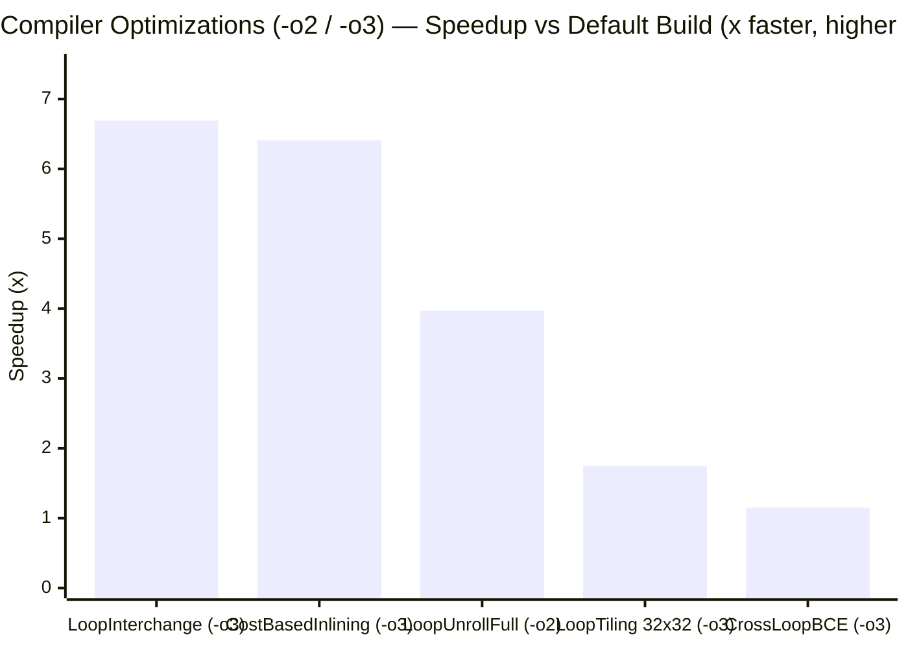

| Optimization Benchmark | Flag | Default Build | Optimized Build | Latency Delta / Speedup |
| :--- | :---: | ---: | ---: | ---: |
| `LoopInterchange` ($512 \times 512$ column-to-row) | `-o3` | 1,974 µs/op | **295.2 µs/op** | **-85.1%** (6.69× faster) |
| `CostBasedInlining` (specialization + devirt) | `-o3` | 163.8 ns/op | **25.57 ns/op** | **-84.4%** (6.41× faster) |
| `LoopUnrollFull` (8-trip fixed loop) | `-o2` | 6.31 ns/op | **1.59 ns/op** | **-74.8%** (3.97× faster) |
| `LoopTiling` ($512 \times 512$ transpose, $32 \times 32$ tiles) | `-o3` | 1,340 µs/op | **767.1 µs/op** | **-42.8%** (1.75× faster) |
| `CrossLoopBCE` (nested token scanner) | `-o3` | 83.93 ns/op | **72.71 ns/op** | **-13.4%** (1.15× faster) |

#### Floating-Point Optimizations (`-fmth`)

```mermaid
xychart-beta
    title "Fast-Math (-fmth): Default IEEE-754 (left bar) vs -fmth (right bar) — Latency (ns/op, lower is better)"
    x-axis ["math.Pow", "math.Log", "math.Cos", "math.Sin", "math.Exp", "ReciprocalDiv (3x)"]
    y-axis "Latency (ns/op)" 0 --> 46
    bar [43.17, 9.00, 9.10, 8.36, 7.49, 4.11]
    bar [17.04, 5.26, 8.08, 8.04, 6.79, 1.95]
```

| Floating-Point Benchmark | Default (IEEE 754) | `-ldflags="all=-fmth"` | Latency Delta / Speedup |
| :--- | ---: | ---: | ---: |
| `math.Pow` (`FastPow` approximation) | 43.17 ns/op | **17.04 ns/op** | **-60.5%** (2.53× faster) |
| `ReciprocalDiv` (`a/d + b/d + c/d`) | 4.11 ns/op | **1.95 ns/op** | **-52.6%** (2.11× faster) |
| `math.Log` (`FastLog` approximation) | 9.00 ns/op | **5.26 ns/op** | **-41.6%** (1.71× faster) |
| `math.Cos` (`FastCos` approximation) | 9.10 ns/op | **8.08 ns/op** | **-11.2%** (1.13× faster) |
| `math.Exp` (`FastExp` approximation) | 7.49 ns/op | **6.79 ns/op** | **-9.3%** (1.10× faster) |

#### Dead Code Elimination & Binary Size (`-o3` and `GOFIPS140=off`)

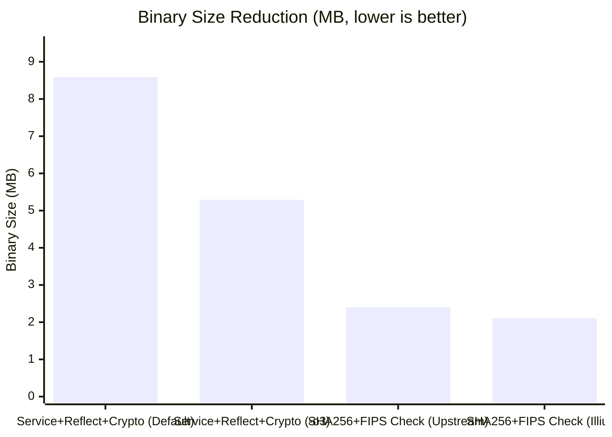

| Binary Target | Baseline Size | Optimized Size | Size Reduction | Details |
| :--- | ---: | ---: | ---: | :--- |
| Service + `reflect.MethodByName` + Crypto | 8.59 MB (Default) | **5.29 MB** (`-ldflags="all=-o3"`) | **-38.4%** | Prunes unused interface & static `MethodByName` targets (`DropTLS`, `DropCrypto`) |
| Large-scale Production Codebase (~300k LOC) | Baseline | `-ldflags="all=-o3"` | **-27.1%** | Two-level compiler + linker dead code elimination |
| Minimal `crypto/sha256` + `crypto/fips140` | 2.40 MB (Upstream) | **2.11 MB** (Illium default) | **-12.0%** | Eliminates `crypto/internal/fips140/check` CAST/integrity init when `GOFIPS140=off` |

---

### 6. Memory Allocation, GC & Stack SBO (`runtime` and `cmd/compile`)

#### Dynamic Slice Allocation & Stack SBO

```mermaid
xychart-beta
    title "Memory Allocation & Stack SBO: Upstream (left bar) vs Illium (right bar) — Latency (ns/op, lower is better)"
    x-axis ["make []byte (64B)", "make []byte (128B)", "make []int (16)", "make []*byte (8)", "make+copy (64B)", "make+copy (128B)", "[]byte(s) (48B)"]
    y-axis "Latency (ns/op)" 0 --> 42
    bar [20.59, 37.86, 38.06, 23.60, 23.27, 38.86, 22.53]
    bar [3.70, 3.71, 3.71, 1.84, 3.93, 4.29, 1.88]
```

| Benchmark | Upstream Go | Illium | Latency Delta | Allocs (`Upstream` → `Illium`) |
| :--- | ---: | ---: | ---: | :---: |
| `DynamicMakeSliceSBO_Ptr8` (`make([]*byte, n)`, 64 B) | 23.60 ns/op | **1.84 ns/op** | **-92.2%** (12.83×) | 1 (64 B) → **0 (0 B)** |
| `StaticStringVarToBytes48` (`[]byte(s)`, 48 B) | 22.53 ns/op | **1.88 ns/op** | **-91.7%** (11.98×) | 1 (48 B) → **0 (0 B)** |
| `DynamicMakeSliceSBO_Int16` (`make([]int, n)`, 128 B) | 38.06 ns/op | **3.71 ns/op** | **-90.3%** (10.26×) | 1 (128 B) → **0 (0 B)** |
| `DynamicMakeSliceSBO_Byte128` (`make([]byte, n)`, 128 B) | 37.86 ns/op | **3.71 ns/op** | **-90.2%** (10.20×) | 1 (128 B) → **0 (0 B)** |
| `DynamicMakeSliceCopySBO_Byte128` (`make`+`copy`, 128 B) | 38.86 ns/op | **4.29 ns/op** | **-89.0%** (9.06×) | 1 (128 B) → **0 (0 B)** |
| `DynamicMakeSliceCopySBO_Byte64` (`make`+`copy`, 64 B) | 23.27 ns/op | **3.93 ns/op** | **-83.1%** (5.92×) | 1 (64 B) → **0 (0 B)** |
| `DynamicMakeSliceSBO_Byte64` (`make([]byte, n)`, 64 B) | 20.59 ns/op | **3.70 ns/op** | **-82.0%** (5.56×) | 1 (64 B) → **0 (0 B)** |
| `MakeSliceCopyZeroDynamic` (`makeslicecopy`, `tolen=0`) | 8.75 ns/op | **5.47 ns/op** | **-37.5%** (1.60×) | 0 → 0 |
| `MakeSliceZeroDynamic` (`makeslice`, `cap=0`) | 7.49 ns/op | **5.19 ns/op** | **-30.7%** (1.44×) | 0 → 0 |
| `DynamicMakeInlinePromotion` (inlined helper + SBO, 96 B) | 186.2 ns/op | **165.9 ns/op** | **-10.9%** (1.12×) | 1 (96 B) → **0 (0 B)** |
| `SpanReclaimChurn` (32 KB span alloc + GC reclaim) | 4,886 ns/op | **4,511 ns/op** | **-7.7%** (1.08×) | 1 (32 KB) → 1 (32 KB) |

#### Garbage Collector, Write Barrier & Sweep (`runtime`)

```mermaid
xychart-beta
    title "GC & Runtime Primitives: Upstream (left bar) vs Illium (right bar) — Latency (ns/op, lower is better)"
    x-axis ["SpanSetReset (STW)", "WbBufFlush1 (Dedup)", "BulkBarrier (Sparse)", "SweepSmallObjects", "ScanBlock (Sparse)"]
    y-axis "Latency (ns/op)" 0 --> 3500
    bar [3424, 1708, 961.0, 562.9, 389.1]
    bar [468.7, 656.8, 543.1, 505.9, 217.0]
```

| Benchmark | Upstream Go | Illium | Latency Delta | Allocs (`Upstream` → `Illium`) |
| :--- | ---: | ---: | ---: | :---: |
| `GCSpanSetResetEmpty` (272 `mcentral` `spanSet.reset` in STW) | 3,424 ns/op | **468.7 ns/op** | **-86.3%** (7.31×) | 0 → 0 |
| `GCWbBufFlushDedup` (`wbBufFlush1`, 512 entries) | 1,708 ns/op | **656.8 ns/op** | **-61.5%** (2.60×) | 0 → 0 |
| `GCScanBlockSparse` (`scanblock`, 2 KB root/stack block) | 389.1 ns/op | **217.0 ns/op** | **-44.2%** (1.79×) | 0 → 0 |
| `GCBulkBarrierBitmapSparseNil` (`bulkBarrierBitmap`, 2 KB) | 961.0 ns/op | **543.1 ns/op** | **-43.5%** (1.77×) | 0 → 0 |
| `GCScanSharedPointers` (4,096-element graph `runtime.GC()`) | 303.6 µs/op | **271.7 µs/op** | **-10.5%** (1.12×) | 0 → 0 |
| `GCSweepSmallObjects` (32 B alloc + periodic GC sweep) | 562.9 ns/op | **505.9 ns/op** | **-10.1%** (1.11×) | 0 → 0 |

#### Allocator, Stack Cache & Write-Barrier Primitives (`runtime`)

```mermaid
xychart-beta
    title "Runtime Allocator, Stack & Barrier Primitives: Baseline (left bar) vs Patched (right bar) — Latency (ns/op, lower is better)"
    x-axis ["PageCacheFlush64", "BulkBarrier (DenseSame)", "BulkBarrier (SparseNil)", "BulkBarrier (SparseClear)", "MCacheRelease (Empty)", "StackCacheClear (Empty)"]
    y-axis "Latency (ns/op)" 0 --> 1600
    bar [1536, 920.5, 741.3, 424.2, 100.6, 72.59]
    bar [263.7, 722.2, 479.4, 108.0, 64.48, 11.89]
```

| Benchmark | Baseline (`70d635fc`) | Patched | Latency Delta | Allocs |
| :--- | ---: | ---: | ---: | :---: |
| `StackCacheClearEmpty` (empty `stackcache_clear` skip) | 72.59 ns/op | **11.89 ns/op** | **-83.6%** (6.11×) | 0 → 0 |
| `PageCacheFlush64` (O(1) `pageCache.flush`, 64 pages) | 1,536 ns/op | **263.7 ns/op** | **-82.8%** (5.82×) | 0 → 0 |
| `BulkBarrierBitmapSparseClear` (2 KB clear, `TrailingZeros32`) | 424.2 ns/op | **108.0 ns/op** | **-74.5%** (3.93×) | 0 → 0 |
| `MCacheReleaseAllEmpty` (4-wide scan + skip `reusableNoscan`) | 100.6 ns/op | **64.48 ns/op** | **-35.9%** (1.56×) | 0 → 0 |
| `GCBulkBarrierBitmapSparseNil` (2 KB copy, `TrailingZeros32`) | 741.3 ns/op | **479.4 ns/op** | **-35.3%** (1.55×) | 0 → 0 |
| `BulkBarrierBitmapDenseSamePtr` (2 KB copy, `dstv == srcv` dedup) | 920.5 ns/op | **722.2 ns/op** | **-21.5%** (1.27×) | 0 → 0 |
| `StackAllocFree8K` (`stackalloc`/`stackfree`, O(1) order lookup) | 13.16 ns/op | **11.29 ns/op** | **-14.2%** (1.17×) | 0 → 0 |
| `MCacheReleaseAllPopulated` (16 spans, batched `heapStats`) | 3,182 ns/op | **2,867 ns/op** | **-9.9%** (1.11×) | 0 → 0 |
| `SpanReclaimChurn` (word-at-a-time `reclaimChunk`) | 9,527 ns/op | **9,247 ns/op** | **-2.9%** (1.03×) | 0 → 0 |
| `GCSweepSmallObjects` (fused inline-mark sweep + full-span skip) | 526.2 ns/op | **517.3 ns/op** | **-1.7%** (1.02×) | 0 → 0 |

> *Measured as interleaved 5-round medians (`-benchtime=400ms -cpu=2`) on `linux/amd64` comparing pre-patch `HEAD` (`70d635fc`) against the patched runtime.*

---

## Notes & Policy

None of the commits will be merged upstream because I cannot guarantee the quality of my code and I do not have time 
to wait for the PR queue.

Want to set it up in Actions? We'll be releasing an action soon so you can seamlessly migrate to our fork. Until then, 
you can check out the examples in my project, which are licensed under the MPL-2.0 license. Once released as a release, 
it will be licensed under the Apache-2.0 license.

Before reporting an issue, you should confirm whether the problem originated with us or our upstream. You should not report 
bugs caused by us to our upstream.

We use streaming version updates, meaning we merge whatever our upstream updates in the master branch. 
We do not maintain LTS versions.

## Download and Install

### Binary Distributions

Official binary distributions are available at https://github.com/404Setup/go/releases.

### Install From Source

If a binary distribution is not available for your combination of
operating system and architecture, visit
https://go.dev/doc/install/source
for source installation instructions.
