# The Go Programming Language Illium

Go is an open source programming language that makes it easy to build simple,
reliable, and efficient software.

This fork is a personal Go branch maintained by 404Setup.

## Features

> This fork does not modify language syntax or break existing standard library APIs.

### Standard Library & Runtime
- **`encoding/base64`**: 2× unrolled AVX2 and SSSE3 assembly (`amd64`), ARM64 NEON, and runtime-detected ARM64 SVE2 vector codecs for standard and URL alphabets, AVX2 CR/LF newline stripping, in-place large-buffer `Decoder.Read`, `4×256` `uint32` little-endian scalar decode LUTs with 6→8 byte chunking, and single-allocation `EncodeToString`.
- **`encoding/json`, `encoding/json/v2`**: Compiled marshal/unmarshal fast paths, SWAR scanning and validation, pooled buffers, exact float paths, and generic `*Of` / `Append*` APIs for both `jsonv2` and `GOEXPERIMENT=nojsonv2`.
- **`encoding/xml`**: Compiled marshal/unmarshal struct plans (`sync/v2.Map`) with O(1) element lookup, pooled encoders and decoders, AVX2/SWAR XML scanning and `EscapeText` (`*bytes.Buffer` / `*strings.Builder`), direct `fastReadSimpleLeafBytes` leaf text decoding, pre-filtered `autoClose` matching, 2-way per-decoder name interning cache, deferred attribute materialization, and `internal/strconv` / inline base-10 numeric parsing.
- **`fmt`, `internal/fmtsort`**: Stack-buffered formatting fast paths (`Sprintf`, `Appendf`, `Sprint`, `Sprintln`, `Append`, `Appendln`, `Errorf`), packed `fmtFlags` bitmask with bulk ASCII/zero padding and division-free base-10/byte formatting, `internal/abi` interface-skip guards, typed primitive slice and struct reflection hoisting, specialized `fmtsort` comparators, embedded string/reader scan states, zero-allocation numeric token parsing, and $O(N)$ recursive `Scanner` reuse.
- **`io`**: Pooled overflow buffers and exact-sized final allocations in `ReadAll`.
- **`sync/v2`**: Generic `Pool[T]` and `Map[K, V]` (`HashTrieMap` with `Shrink()` and single-load `Load` fast path).
- **`sync/v2/container`**: Generic ordered/sorted maps (`OrderedMap`, `ConcurrentSkipListMap`, `LinkedHashMap`, `TreeMap`) with zero-alloc `internal/abi` CAS/CAD equality, capped node freelists, and lock-free `ConcurrentSkipListMap.First`.
- **`sync/atomic/v2`**: Generic `Value[T]` without interface boxing.
- **`net`**: TTL-aware DNS cache (`GODEBUG=netdnscache=0`) with immutable address/TXT caching and `singleflight`-free cache hits, lock-free `ipv6ZoneCache` snapshots, pooled net-file buffers, O(1) RFC 6724 policy classification, and stack-buffered formatting.
- **`net/http`, `net/textproto`, `net/url`**: Allocation and throughput optimizations across HTTP/1.1, HTTP/2, and HTTP/3.
- **`net/http/server`**: HTTP router with path parameters, route groups, pooled contexts, and middleware.
- **`reflect`**: Fast paths for `Equal`, `DeepEqual`, `Comparable`, `Call`, `Select`, `MapKeys`, and struct fields.
- **`runtime`**: Faster span reclamation, GC sweep, bit-scanning, stack/page/mcache management, and write-barrier deduplication.
- **`cmd/compile`**: Stack small-buffer optimization for non-escaping slices/strings and static constant lowering.

### Compiler & Linker Flags
- **`-ldflags="-o2"`**: Bounded loop unrolling and post-SCCP/prove dead branch elimination.
- **`-ldflags="-o3"`**: Includes `-o2`, plus cost-based inlining, loop interchange and $32 \times 32$ tiling, dead loop/BCE passes, and two-stage reflection/interface DCE.
- **`-ldflags="-fmth"`**: Fast-math SSA reductions, reciprocal division, FMA contraction, polynomial math approximations, and `FTZ`/`DAZ` mode (may relax strict IEEE 754 semantics).

Use `all=` (e.g., `-ldflags="all=-o3"`) to apply flags across all dependencies.

---

## Benchmarks

All benchmarks below were executed on `linux/amd64` (Intel Xeon Platinum 8481C) comparing upstream Go against Illium.

### 1. `sync/v2`, `sync/v2/container`, and `sync/atomic/v2`

```mermaid
xychart-beta
    title "Concurrency Primitives: v1 (left bar) vs v2 (right bar) — Latency (ns/op, lower is better)"
    x-axis ["Map.Load (Hits)", "Map.Mixed", "Pool (Struct Val)", "atomic.Store (int)", "atomic.Swap (int)", "atomic.CAS Mismatch"]
    y-axis "Latency (ns/op)" 0 --> 75
    bar [12.14, 52.23, 25.90, 17.18, 18.31, 69.03]
    bar [7.11, 38.81, 6.23, 5.77, 7.55, 9.79]
```

| Benchmark | `v1` (`sync` / `atomic`) | `v2` (`sync/v2` / `atomic/v2`) | Latency Delta | Allocs (`v1` → `v2`) |
| :--- | ---: | ---: | ---: | :---: |
| `MapLoadFreshEmpty` | 2.43 ns/op | **2.05 ns/op** | **-15.6%** (1.19×) | 0 → 0 |
| `MapLoadMostlyHits` | 12.14 ns/op | **7.11 ns/op** | **-41.4%** (1.71×) | 0 → 0 |
| `MapMixed` | 52.23 ns/op | **38.81 ns/op** | **-25.7%** (1.35×) | 6 B → 4 B |
| `PoolPointer` | 6.52 ns/op | **6.79 ns/op** | ~0% (parity) | 0 → 0 |
| `PoolValue` (32B struct) | 25.90 ns/op | **6.23 ns/op** | **-76.0%** (4.16×) | 1 (32 B) → **0 (0 B)** |
| `atomic.Value Load (int)` | 1.03 ns/op | **0.35 ns/op** | **-66.0%** (2.94×) | 0 → 0 |
| `atomic.Value Load (ptr, parallel)` | 4.70 ns/op | **3.66 ns/op** | **-22.1%** (1.28×) | 0 → 0 |
| `atomic.Value Store (int)` | 17.18 ns/op | **5.77 ns/op** | **-66.4%** (2.98×) | 7 B → **0 B** |
| `atomic.Value Swap (int)` | 18.31 ns/op | **7.55 ns/op** | **-58.8%** (2.43×) | 7 B → **0 B** |
| `atomic.Value CAS Mismatch (Large)` | 69.03 ns/op | **9.79 ns/op** | **-85.8%** (7.05×) | 1 (128 B) → **0 (0 B)** |

```mermaid
xychart-beta
    title "sync/v2/container Ordered & Sorted Maps — Latency by Operation (ns/op, lower is better)"
    x-axis ["LinkedHashMap", "OrderedMap (Concurrent)", "TreeMap (Sorted)", "ConcurrentSkipListMap"]
    y-axis "Latency (ns/op)" 0 --> 330
    bar [10.79, 21.00, 53.28, 85.54]
    bar [11.88, 47.61, 51.49, 120.03]
    bar [66.99, 252.73, 281.83, 319.97]
```
> *Bars per container (left to right): **Load**, **Store**, and **Delete+Store Churn** across 1,024 entries (`OrderedMap` parallel hit load: **9.04 ns/op**, 0 allocs/op).*

#### `sync/v2` & `sync/v2/container` (`2a4868c0` → Current, `-cpu=2`)

| Benchmark | Baseline (`2a4868c0`) | Current | Latency Delta | Allocs |
| :--- | ---: | ---: | ---: | :---: |
| `OrderedMap` (`Load` / `Churn` / `All`) | 37.50 / 434.1 / 6,679 ns/op | **33.46 / 408.7 / 6,379 ns/op** | **-10.8% / -5.9% / -4.5%** | 0 / 2 / 3 |
| `LinkedHashMap.Churn` | 114.2 ns/op | **107.7 ns/op** | **-5.7%** | 0 (0 B) |
| `TreeMap.Churn` | 435.4 ns/op | **401.6 ns/op** | **-7.8%** | 0 (0 B) |
| `ConcurrentSkipListMap.Churn` | 481.4 ns/op | **477.7 ns/op** | **-0.8%** | 1 (65 B) |

> *New zero-alloc container fast paths (`-cpu=2`): `CompareAndSwapMiss` (`ordered` / `linked` / `tree` / `skip`, 16B struct) **40.26 / 13.86 / 15.75 / 37.55 ns/op** (0 allocs); `ConcurrentSkipListMap.First` parallel **2.01 ns/op** (0 allocs); `Map.CompareAndSwap` (32B struct) **25.26 ns/op** (0 allocs).*

---

### 2. `net/http`, `net/textproto`, and `net/url`

```mermaid
xychart-beta
    title "net/http: Go 1.27.3 (left bar) vs Illium (right bar) — Latency (ns/op, lower is better)"
    x-axis ["ReadRequest (Wrk)", "ServerMatch", "ReadRequest (Chrome)", "ReadMIMEHeader", "ServerKeepAliveLite", "ServerHandlerTypeLen", "ReverseProxy", "ServerKeepAlive"]
    y-axis "Latency (ns/op)" 0 --> 7600
    bar [984.1, 919.7, 2811, 2591, 4031, 5394, 6124, 7414]
    bar [246.9, 511.9, 1556, 1658, 759.4, 1300, 602.4, 2374]
```

#### Server, Client, Routing & Proxy (`-cpu=2`, Go `1.27.3` baseline)

| Benchmark | Go `1.27.3` | Illium | Latency Delta | Allocs (`1.27.3` → `Illium`) |
| :--- | ---: | ---: | ---: | :---: |
| `ClientServer/h1` (`1×` / `64×` parallel) | 24.03 / 50.46 µs/op | **10.02 / 13.63 µs/op** | **-58.3% / -73.0%** | 65 / 105 → **20 / 39** |
| `ClientServer/h2` (`1×` / `64×` parallel) | 35.60 / 25.72 µs/op | **26.73 / 17.33 µs/op** | **-24.9% / -32.6%** | 65 / 67 → **32 / 30** |
| `ClientServerParallel/64` (`https1`) | 818.8 µs/op | **29.45 µs/op** | **-96.4%** (27.80×) | 795 → **58** |
| `ServerFakeConn` (`KeepAlive` / `Lite`) | 7,414 / 4,031 ns/op | **2,374 / 759.4 ns/op** | **-68.0% / -81.2%** | 22 / 12 → **6 / 2** |
| `ServerFakeConnNoKeepAlive` | 13.73 µs/op | **5.44 µs/op** | **-60.4%** (2.53×) | 47 (4,955 B) → **22 (3,049 B)** |
| `ServerHandlerTypeLen` | 5,394 ns/op | **1,300 ns/op** | **-75.9%** (4.15×) | 19 (2,129 B) → **5 (532 B)** |
| `ServeMux` (180 routes) | 43.17 µs/op | **26.50 µs/op** | **-38.6%** (1.63×) | 360 (17,280 B) → 360 (17,284 B) |
| `ServeMuxParallel` (`Static` / `Param`) | 139.9 / 222.8 ns/op | **45.04 / 100.9 ns/op** | **-67.8% / -54.7%** | 0 / 2 → **0 / 1** |
| `ServerMatch` (`ServeMux` lookup) | 919.7 ns/op | **511.9 ns/op** | **-44.3%** (1.80×) | 10 (791 B) → **5 (568 B)** |
| `ReverseProxy.ServeHTTP` (`httputil`) | 6,124 ns/op | **602.4 ns/op** | **-90.2%** (10.17×) | 12 (34,224 B) → **9 (1,170 B)** |
| `Redirect` (clean path) | 440.0 ns/op | **96.49 ns/op** | **-78.1%** (4.56×) | 5 (224 B) → **1 (32 B)** |
| `ServeContent` (`GET` 4 KiB / `HEAD` range) | 2,669 / 8,051 ns/op | **997.7 / 4,671 ns/op** | **-62.6% / -42.0%** | 16 / 110 → **11 / 66** |
| `ResponseRecorder.Result` (`httptest`) | 979.3 ns/op | **654.2 ns/op** | **-33.2%** (1.50×) | 12 (1,112 B) → **8 (1,024 B)** |

#### Parsing, Headers, Cookies, Query & Formatting

| Benchmark | Go `1.27.3` | Illium | Latency Delta | Allocs (`1.27.3` → `Illium`) |
| :--- | ---: | ---: | ---: | :---: |
| `ReadRequest` (`Wrk` / `Chrome`) | 984.1 / 2,811 ns/op | **246.9 / 1,556 ns/op** | **-74.9% / -44.6%** | 7 / 13 → **2 / 5** |
| `ReadMIMEHeader` (`textproto`, client / server) | 2,591 / 1,823 ns/op | **1,658 / 1,193 ns/op** | **-36.0% / -34.6%** | 16 / 16 → **7 / 7** |
| `MIMEHeader.Get` (`textproto`, lower / missing) | 90.04 / 77.25 ns/op | **57.29 / 36.35 ns/op** | **-36.4% / -52.9%** | 1 / 1 → **0 / 0** |
| `ReadSetCookies` | 1,920 ns/op | **592.7 ns/op** | **-69.1%** (3.24×) | 21 (1,168 B) → **2 (400 B)** |
| `ParseSetCookie` | 1,132 ns/op | **357.8 ns/op** | **-68.4%** (3.16×) | 13 (640 B) → **1 (192 B)** |
| `Cookie.String` | 433.9 ns/op | **186.6 ns/op** | **-57.0%** (2.33×) | 1 (176 B) → **1 (128 B)** |
| `Header.WriteSubset` (`bufio` / `Builder`) | 315.0 / 528.6 ns/op | **217.7 / 266.5 ns/op** | **-30.9% / -49.6%** | 0 / 4 → **0 / 1** |
| `ResponseStatusLine` | 15.95 ns/op | **3.26 ns/op** | **-79.6%** (4.90×) | 0 → 0 |
| `NewRequest` (empty `*bytes.Buffer`) | 445.1 ns/op | **318.4 ns/op** | **-28.5%** (1.40×) | 5 (560 B) → **3 (512 B)** |
| `BasicAuth` / `SetBasicAuth` | 106.8 / 129.1 ns/op | **71.10 / 66.83 ns/op** | **-33.4% / -48.2%** | 2 / 3 → **1 / 2** |
| `ParseForm` (POST w/ CL, 6 / 32 fields) | 1,742 / 9,880 ns/op | **1,283 / 7,712 ns/op** | **-26.3% / -21.9%** | 24 / 82 → **15 / 28** |
| `url.ParseQuery` (64 distinct keys) | 10.95 µs/op | **6.78 µs/op** | **-38.1%** (1.62×) | 75 (11,736 B) → **14 (7,000 B)** |
| `ClientRequestHeaders/1000` (`http2`) | 1,329 µs/op | **948.9 µs/op** | **-28.6%** (1.40×) | 4,061 (320 KB) → **3,022 (225 KB)** |
| `ClientResponseHeaders/10` (`http2`) | 57.75 µs/op | **55.03 µs/op** | **-4.7%** (1.05×) | 117 (8,818 B) → **75 (5,509 B)** |

#### Routing, Chunked/Body I/O, Proxy, HTTP/2 & HTTP/3 Primitives

```mermaid
xychart-beta
    title "net/http Primitives: Baseline (left bar) vs Patched (right bar) — Latency (ns/op, lower is better)"
    x-axis ["ChunkedReader (32Bx64)", "ReverseProxyStream", "RequestClone", "QPACKHeaders (h3)", "WriteBody (Bytes)", "ServeMux (Static)"]
    y-axis "Latency (ns/op)" 0 --> 3400
    bar [3196, 1875, 520.9, 360.6, 162.1, 101.1]
    bar [2347, 1183, 483.4, 262.6, 78.5, 62.4]
```

| Benchmark | Baseline (`f0012dea`) | Patched | Latency Delta | Allocs (`Baseline` → `Patched`) |
| :--- | ---: | ---: | ---: | :---: |
| `TransferWriterInMemoryBody` (`Bytes` / `Strings`) | 162.1 / 162.6 ns/op | **78.5 / 81.7 ns/op** | **-51.6% / -49.8%** | 3 (64 B) → **2 (40 B)** |
| `ServeMuxSnap` (`Static` / `Param`) | 101.1 / 178.2 ns/op | **62.4 / 173.2 ns/op** | **-38.3% / -2.8%** | 0 / 1 → 0 / 1 |
| `ReverseProxyStreaming` (`FlushInterval=-1`) | 1,875 ns/op | **1,183 ns/op** | **-36.9%** (1.58×) | 21 (2,085 B) → **15 (1,843 B)** |
| `DirList` (200 entries) | 55.21 µs/op | **36.51 µs/op** | **-33.9%** (1.51×) | 657 → **251** |
| `ChunkedWriter/Unbuffered` | 21.7 ns/op | **15.8 ns/op** | **-27.2%** (1.37×) | 0 → 0 |
| `QPACKPrefixedString/EncoderHeaders` (`http3`) | 360.6 ns/op | **262.6 ns/op** | **-27.2%** (1.37×) | 4 (184 B) → **1 (16 B)** |
| `ChunkedReader/SmallChunks32Bx64` | 3,196 ns/op | **2,347 ns/op** | **-26.6%** (1.36×) | 1 (48 B) → 1 (48 B) |
| `RequestClone` | 520.9 ns/op | **483.4 ns/op** | **-7.2%** (1.08×) | 5 (896 B) → **4 (880 B)** |
| `StreamWriteVarint` (`http3`) | 111.6 ns/op | **105.1 ns/op** | **-5.8%** (1.06×) | 0 → 0 |
| `ClientServer/h2` | 27.78 µs/op | **26.41 µs/op** | **-4.9%** (1.05×) | 32 (4,508 B) → **27 (4,427 B)** |
| `ClientResponseHeaders/10` (`http2`) | 42.98 µs/op | **41.65 µs/op** | **-3.1%** (1.03×) | 75 → **71** |
| `ReverseProxy.ServeHTTP` (`httputil`) | 579.6 ns/op | **562.3 ns/op** | **-3.0%** (1.03×) | 9 (1,170 B) → **7 (1,154 B)** |

#### `net/http/server` vs `net/http.ServeMux`

```mermaid
xychart-beta
    title "net/http.ServeMux (left bar) vs net/http/server (right bar) — Latency (ns/op, lower is better)"
    x-axis ["StaticRoute", "ParallelParam1", "Param1Route", "Param3Route", "JSONResponse", "QueryParam"]
    y-axis "Latency (ns/op)" 0 --> 950
    bar [82.87, 117.0, 227.0, 378.3, 563.2, 874.7]
    bar [66.96, 41.55, 83.05, 129.5, 509.9, 132.1]
```

| Benchmark | `net/http.ServeMux` | `net/http/server` | Latency Delta | Allocs (`ServeMux` → `server`) |
| :--- | ---: | ---: | ---: | :---: |
| `StaticRoute` (50+ routes) | 82.87 ns/op | **66.96 ns/op** | **-19.2%** (1.24×) | 0 → 0 |
| `Param1Route` (`/api/v1/users/{id}`) | 227.0 ns/op | **83.05 ns/op** | **-63.4%** (2.73×) | 1 (16 B) → **0 (0 B)** |
| `Param3Route` (3 params) | 378.3 ns/op | **129.5 ns/op** | **-65.8%** (2.92×) | 1 (48 B) → **0 (0 B)** |
| `ParallelParamRoute` (`-cpu=2`) | 117.0 ns/op | **41.55 ns/op** | **-64.5%** (2.82×) | 1 (16 B) → **0 (0 B)** |
| `QueryParam` (2 keys) | 874.7 ns/op | **132.1 ns/op** | **-84.9%** (6.62×) | 6 (464 B) → **0 (0 B)** |
| `JSONResponse` (`c.JSON` vs `json.Marshal`) | 563.2 ns/op | **509.9 ns/op** | **-9.5%** (1.10×) | 2 (64 B) → **0 (0 B)** |

> *Additional `net/http/server` medians: `WildcardRoute` **95.76 ns/op** (0 allocs), `MiddlewareChain5` **116.5 ns/op** (0 allocs), `MaxInFlight` **74.75 ns/op** (0 allocs), `Accepts` **648.8 ns/op** (0 allocs), `BindJSON` **904.7 ns/op** (2 allocs, 40 B), `CompressGzip` (~2.6 KiB) **11.86 µs/op** (0 allocs, 52 B).*

---

### 3. `net` DNS Resolver Cache & Fast Paths

```mermaid
xychart-beta
    title "net DNS Resolver: Uncached (left bar) vs Cached (right bar) — Latency (ns/op, lower is better)"
    x-axis ["LookupHost (Dual-Stack)", "LookupHost (Parallel)", "LookupTXT"]
    y-axis "Latency (ns/op)" 0 --> 46000
    bar [44548, 44548, 3612]
    bar [1436, 1279, 467.6]
```

| Benchmark | Uncached (`netdnscache=0`) | Cached (Default) | Latency Delta | Allocs (`Uncached` → `Cached`) |
| :--- | ---: | ---: | ---: | :---: |
| `DNSLookupHost` (A + AAAA + RFC 6724) | 44,548 ns/op | **1,436 ns/op** | **-96.8%** (31.02×) | 74 (10,136 B) → **10 (288 B)** |
| `DNSLookupHostParallel` | 44,548 ns/op | **1,279 ns/op** | **-97.1%** (34.83×) | 74 (10,136 B) → **10 (288 B)** |
| `DNSLookupTXT` | 3,612 ns/op | **467.6 ns/op** | **-87.1%** (7.72×) | 22 (4,216 B) → **5 (112 B)** |

#### `net` Hardening & Fast Paths (`2a4868c0` → Current, `-cpu=2`)

| Benchmark | Baseline (`2a4868c0`) | Current | Latency Delta | Allocs (`Baseline` → `Current`) |
| :--- | ---: | ---: | ---: | :---: |
| `DNSLookupHostCached` | 2,243 ns/op | **1,241 ns/op** | **-44.7%** (1.81×) | 10 (288 B) → **1 (32 B)** |
| `DNSLookupHostCachedParallel` | 1,506 ns/op | **892.4 ns/op** | **-40.7%** (1.69×) | 10 (288 B) → **1 (32 B)** |
| `DNSLookupTXTCached` | 746.5 ns/op | **441.8 ns/op** | **-40.8%** (1.69×) | 5 (112 B) → **1 (16 B)** |
| `InterfacesAndMulticastAddrs` | 142.4 µs/op | **72.50 µs/op** | **-49.1%** (1.96×) | 40 (136,163 B) → **38 (5,130 B)** |
| `ParseIPValidIPv4` / `ParseIP` | 44.75 / 3,006 ns/op | **34.33 / 2,536 ns/op** | **-23.3% / -15.6%** | 0 / 16 → 0 / 16 |
| `IP.String` (`IPv4` / `IPv6`) | 116.1 / 1,640 ns/op | **100.2 / 1,438 ns/op** | **-13.7% / -12.3%** | 2 / 11 → 2 / 11 |
| `IP.Equal` (`IPv4`) | 8.04 ns/op | **5.94 ns/op** | **-26.1%** (1.35×) | 0 → 0 |
| `TCP6OneShot` | 100.9 µs/op | **89.82 µs/op** | **-11.0%** (1.12×) | 26 (2,344 B) → **25 (2,296 B)** |

> *New `net` fast paths (`-cpu=2`): `ZoneCacheName` **19.65 ns/op** (0 allocs); `IPNet.String` (`IPv4` / `IPv6`) **71.39 / 179.4 ns/op** (1 alloc, 16 B); `AddrStrings` (`UDPv4` / `TCPZone` / `UDPZone`) **69.32 / 180.3 / 184.4 ns/op** (1 alloc); `ReverseAddr` (`IPv4` / `IPv6`) **117.3 / 153.4 ns/op** (1 alloc); `DNSLookupIPAddrCached` **1,403 ns/op** (3 allocs, 136 B, isolated slab without `singleflight`).*

---

### 4. `reflect` Optimizations

```mermaid
xychart-beta
    title "reflect: Upstream (left bar) vs Illium (right bar) — Latency (ns/op, lower is better)"
    x-axis ["Equal (Struct)", "Comparable", "AppendSlice", "DeepEqual ([]int)", "Call (Method)", "Call (Variadic)", "MapsDeepEqual", "Select (8)", "VisibleFields"]
    y-axis "Latency (ns/op)" 0 --> 750
    bar [54.53, 170.8, 60.58, 82.79, 250.1, 328.0, 340.9, 371.6, 727.3]
    bar [6.28, 16.36, 29.37, 31.70, 184.9, 229.8, 141.6, 314.4, 223.2]
```

| Benchmark | Upstream Go | Illium | Latency Delta | Allocs (`Upstream` → `Illium`) |
| :--- | ---: | ---: | ---: | :---: |
| `Comparable` (struct) | 170.8 ns/op | **16.36 ns/op** | **-90.4%** (10.44×) | 7 (100 B) → **0 (0 B)** |
| `Equal/RegularMemory` | 54.53 ns/op | **6.28 ns/op** | **-88.5%** (8.68×) | 0 → 0 |
| `DeepEqual/[][6]uint8` | 144.7 ns/op | **35.81 ns/op** | **-75.3%** (4.04×) | 0 → 0 |
| `VisibleFields/Flat` | 727.3 ns/op | **223.2 ns/op** | **-69.3%** (3.26×) | 11 (1,080 B) → **2 (624 B)** |
| `DeepEqual/[]int` | 82.79 ns/op | **31.70 ns/op** | **-61.7%** (2.61×) | 0 → 0 |
| `MapsDeepEqual` | 340.9 ns/op | **141.6 ns/op** | **-58.5%** (2.41×) | 6 (48 B) → **0 (0 B)** |
| `AppendSlice` | 60.58 ns/op | **29.37 ns/op** | **-51.5%** (2.06×) | 2 (48 B) → **1 (24 B)** |
| `MapKeys/string/1024` | 39.76 µs/op | **24.68 µs/op** | **-37.9%** (1.61×) | 1,025 (43,648 B) → **5 (46,720 B)** |
| `MapKeys/int/64` | 2.349 µs/op | **1.500 µs/op** | **-36.2%** (1.57×) | 65 (2,304 B) → **2 (2,304 B)** |
| `Convert/CanConvert` | 9.40 ns/op | **6.20 ns/op** | **-34.0%** (1.52×) | 0 → 0 |
| `Convert/IntToString` | 56.74 ns/op | **38.64 ns/op** | **-31.9%** (1.47×) | 2 (20 B) → 2 (20 B) |
| `CallSerial/Variadic` | 328.0 ns/op | **229.8 ns/op** | **-29.9%** (1.43×) | 4 (80 B) → **3 (56 B)** |
| `CallSerial/Method` | 250.1 ns/op | **184.9 ns/op** | **-26.1%** (1.35×) | 3 (40 B) → **2 (32 B)** |
| `Select/8` | 371.6 ns/op | **314.4 ns/op** | **-15.4%** (1.18×) | 11 (512 B) → **4 (456 B)** |

---

### 5. Compiler & Linker Optimizations (`-o2`, `-o3`, `-fmth`, and `GOFIPS140`)

#### Loop, Inlining & Bounds Optimizations (`-o2` and `-o3`)

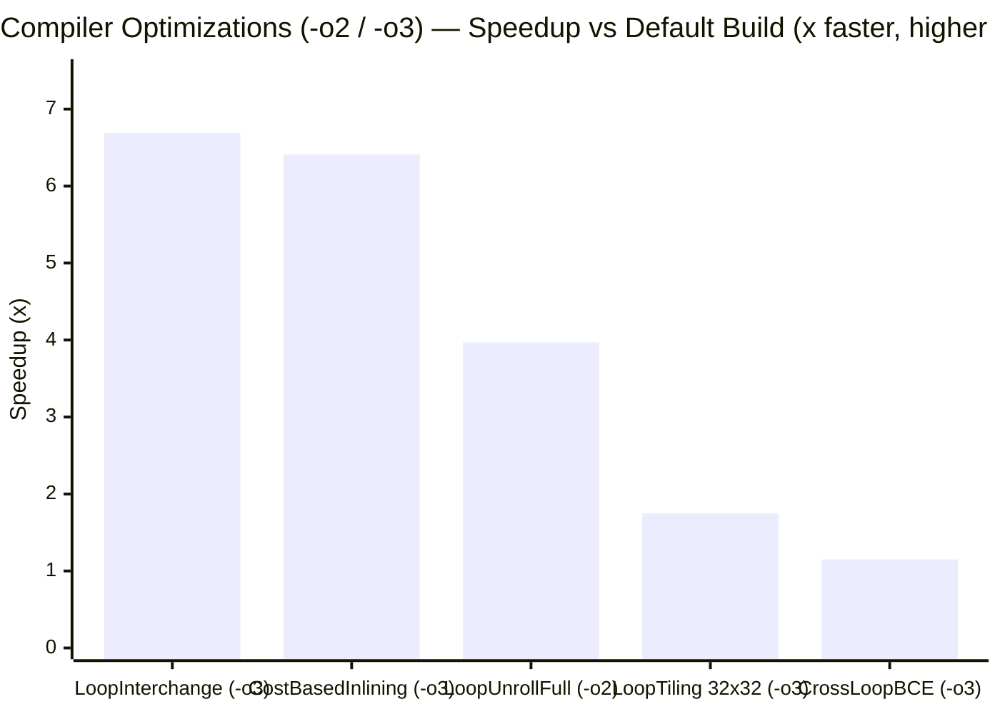

| Optimization Benchmark | Flag | Default Build | Optimized Build | Latency Delta / Speedup |
| :--- | :---: | ---: | ---: | ---: |
| `LoopInterchange` ($512 \times 512$ column-to-row) | `-o3` | 1,974 µs/op | **295.2 µs/op** | **-85.1%** (6.69× faster) |
| `CostBasedInlining` (specialization + devirt) | `-o3` | 163.8 ns/op | **25.57 ns/op** | **-84.4%** (6.41× faster) |
| `LoopUnrollFull` (8-trip fixed loop) | `-o2` | 6.31 ns/op | **1.59 ns/op** | **-74.8%** (3.97× faster) |
| `LoopTiling` ($512 \times 512$ transpose, $32 \times 32$ tiles) | `-o3` | 1,340 µs/op | **767.1 µs/op** | **-42.8%** (1.75× faster) |
| `CrossLoopBCE` (nested token scanner) | `-o3` | 83.93 ns/op | **72.71 ns/op** | **-13.4%** (1.15× faster) |

#### Floating-Point Optimizations (`-fmth`)

```mermaid
xychart-beta
    title "Fast-Math (-fmth): Default IEEE-754 (left bar) vs -fmth (right bar) — Latency (ns/op, lower is better)"
    x-axis ["math.Pow", "math.Log", "math.Cos", "math.Sin", "math.Exp", "ReciprocalDiv (3x)"]
    y-axis "Latency (ns/op)" 0 --> 46
    bar [43.17, 9.00, 9.10, 8.36, 7.49, 4.11]
    bar [17.04, 5.26, 8.08, 8.04, 6.79, 1.95]
```

| Floating-Point Benchmark | Default (IEEE 754) | `-ldflags="all=-fmth"` | Latency Delta / Speedup |
| :--- | ---: | ---: | ---: |
| `math.Pow` (`FastPow` approximation) | 43.17 ns/op | **17.04 ns/op** | **-60.5%** (2.53× faster) |
| `ReciprocalDiv` (`a/d + b/d + c/d`) | 4.11 ns/op | **1.95 ns/op** | **-52.6%** (2.11× faster) |
| `math.Log` (`FastLog` approximation) | 9.00 ns/op | **5.26 ns/op** | **-41.6%** (1.71× faster) |
| `math.Cos` (`FastCos` approximation) | 9.10 ns/op | **8.08 ns/op** | **-11.2%** (1.13× faster) |
| `math.Exp` (`FastExp` approximation) | 7.49 ns/op | **6.79 ns/op** | **-9.3%** (1.10× faster) |

#### Dead Code Elimination & Binary Size (`-o3` and `GOFIPS140=off`)

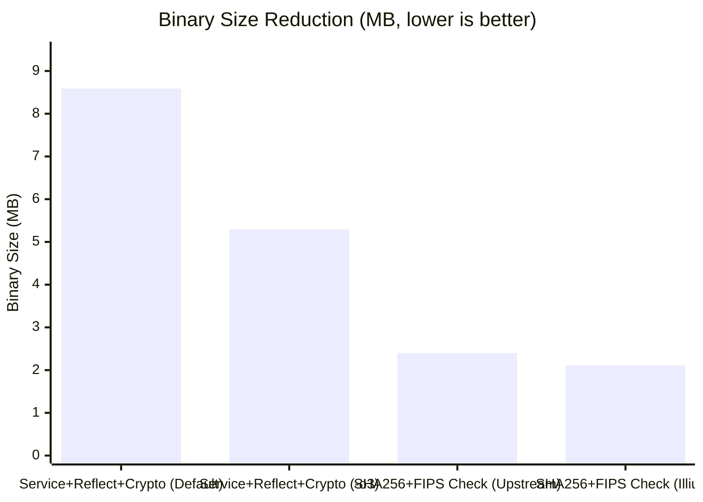

| Binary Target | Baseline Size | Optimized Size | Size Reduction | Details |
| :--- | ---: | ---: | ---: | :--- |
| Service + `reflect.MethodByName` + Crypto | 8.59 MB (Default) | **5.29 MB** (`-ldflags="all=-o3"`) | **-38.4%** | Prunes unused interface & static `MethodByName` targets (`DropTLS`, `DropCrypto`) |
| Large-scale Production Codebase (~300k LOC) | Baseline | `-ldflags="all=-o3"` | **-27.1%** | Two-level compiler + linker dead code elimination |
| Minimal `crypto/sha256` + `crypto/fips140` | 2.40 MB (Upstream) | **2.11 MB** (Illium default) | **-12.0%** | Eliminates `crypto/internal/fips140/check` CAST/integrity init when `GOFIPS140=off` |

---

### 6. Memory Allocation, GC & Stack SBO (`runtime` and `cmd/compile`)

#### Dynamic Slice Allocation & Stack SBO

```mermaid
xychart-beta
    title "Memory Allocation & Stack SBO: Upstream (left bar) vs Illium (right bar) — Latency (ns/op, lower is better)"
    x-axis ["make []byte (64B)", "make []byte (128B)", "make []int (16)", "make []*byte (8)", "make+copy (64B)", "make+copy (128B)", "[]byte(s) (48B)"]
    y-axis "Latency (ns/op)" 0 --> 42
    bar [20.59, 37.86, 38.06, 23.60, 23.27, 38.86, 22.53]
    bar [3.70, 3.71, 3.71, 1.84, 3.93, 4.29, 1.88]
```

| Benchmark | Upstream Go | Illium | Latency Delta | Allocs (`Upstream` → `Illium`) |
| :--- | ---: | ---: | ---: | :---: |
| `DynamicMakeSliceSBO_Ptr8` (`make([]*byte, n)`, 64 B) | 23.60 ns/op | **1.84 ns/op** | **-92.2%** (12.83×) | 1 (64 B) → **0 (0 B)** |
| `StaticStringVarToBytes48` (`[]byte(s)`, 48 B) | 22.53 ns/op | **1.88 ns/op** | **-91.7%** (11.98×) | 1 (48 B) → **0 (0 B)** |
| `DynamicMakeSliceSBO_Int16` (`make([]int, n)`, 128 B) | 38.06 ns/op | **3.71 ns/op** | **-90.3%** (10.26×) | 1 (128 B) → **0 (0 B)** |
| `DynamicMakeSliceSBO_Byte128` (`make([]byte, n)`, 128 B) | 37.86 ns/op | **3.71 ns/op** | **-90.2%** (10.20×) | 1 (128 B) → **0 (0 B)** |
| `DynamicMakeSliceCopySBO_Byte128` (`make`+`copy`, 128 B) | 38.86 ns/op | **4.29 ns/op** | **-89.0%** (9.06×) | 1 (128 B) → **0 (0 B)** |
| `DynamicMakeSliceCopySBO_Byte64` (`make`+`copy`, 64 B) | 23.27 ns/op | **3.93 ns/op** | **-83.1%** (5.92×) | 1 (64 B) → **0 (0 B)** |
| `DynamicMakeSliceSBO_Byte64` (`make([]byte, n)`, 64 B) | 20.59 ns/op | **3.70 ns/op** | **-82.0%** (5.56×) | 1 (64 B) → **0 (0 B)** |
| `MakeSliceCopyZeroDynamic` (`makeslicecopy`, `tolen=0`) | 8.75 ns/op | **5.47 ns/op** | **-37.5%** (1.60×) | 0 → 0 |
| `MakeSliceZeroDynamic` (`makeslice`, `cap=0`) | 7.49 ns/op | **5.19 ns/op** | **-30.7%** (1.44×) | 0 → 0 |
| `DynamicMakeInlinePromotion` (inlined helper + SBO, 96 B) | 186.2 ns/op | **165.9 ns/op** | **-10.9%** (1.12×) | 1 (96 B) → **0 (0 B)** |
| `SpanReclaimChurn` (32 KB span alloc + GC reclaim) | 4,886 ns/op | **4,511 ns/op** | **-7.7%** (1.08×) | 1 (32 KB) → 1 (32 KB) |

#### Garbage Collector, Write Barrier & Sweep (`runtime`)

```mermaid
xychart-beta
    title "GC & Runtime Primitives: Upstream (left bar) vs Illium (right bar) — Latency (ns/op, lower is better)"
    x-axis ["SpanSetReset (STW)", "WbBufFlush1 (Dedup)", "BulkBarrier (Sparse)", "SweepSmallObjects", "ScanBlock (Sparse)"]
    y-axis "Latency (ns/op)" 0 --> 3500
    bar [3424, 1708, 961.0, 562.9, 389.1]
    bar [468.7, 656.8, 543.1, 505.9, 217.0]
```

| Benchmark | Upstream Go | Illium | Latency Delta | Allocs (`Upstream` → `Illium`) |
| :--- | ---: | ---: | ---: | :---: |
| `GCSpanSetResetEmpty` (272 `mcentral` `spanSet.reset` in STW) | 3,424 ns/op | **468.7 ns/op** | **-86.3%** (7.31×) | 0 → 0 |
| `GCWbBufFlushDedup` (`wbBufFlush1`, 512 entries) | 1,708 ns/op | **656.8 ns/op** | **-61.5%** (2.60×) | 0 → 0 |
| `GCScanBlockSparse` (`scanblock`, 2 KB root/stack block) | 389.1 ns/op | **217.0 ns/op** | **-44.2%** (1.79×) | 0 → 0 |
| `GCBulkBarrierBitmapSparseNil` (`bulkBarrierBitmap`, 2 KB) | 961.0 ns/op | **543.1 ns/op** | **-43.5%** (1.77×) | 0 → 0 |
| `GCScanSharedPointers` (4,096-element graph `runtime.GC()`) | 303.6 µs/op | **271.7 µs/op** | **-10.5%** (1.12×) | 0 → 0 |
| `GCSweepSmallObjects` (32 B alloc + periodic GC sweep) | 562.9 ns/op | **505.9 ns/op** | **-10.1%** (1.11×) | 0 → 0 |

#### Allocator, Stack Cache & Write-Barrier Primitives (`runtime`)

```mermaid
xychart-beta
    title "Runtime Allocator, Stack & Barrier Primitives: Baseline (left bar) vs Patched (right bar) — Latency (ns/op, lower is better)"
    x-axis ["PageCacheFlush64", "BulkBarrier (DenseSame)", "BulkBarrier (SparseNil)", "BulkBarrier (SparseClear)", "MCacheRelease (Empty)", "StackCacheClear (Empty)"]
    y-axis "Latency (ns/op)" 0 --> 1600
    bar [1536, 920.5, 741.3, 424.2, 100.6, 72.59]
    bar [263.7, 722.2, 479.4, 108.0, 64.48, 11.89]
```

| Benchmark | Baseline (`70d635fc`) | Patched | Latency Delta | Allocs |
| :--- | ---: | ---: | ---: | :---: |
| `StackCacheClearEmpty` (empty `stackcache_clear` skip) | 72.59 ns/op | **11.89 ns/op** | **-83.6%** (6.11×) | 0 → 0 |
| `PageCacheFlush64` (O(1) `pageCache.flush`, 64 pages) | 1,536 ns/op | **263.7 ns/op** | **-82.8%** (5.82×) | 0 → 0 |
| `BulkBarrierBitmapSparseClear` (2 KB clear, `TrailingZeros32`) | 424.2 ns/op | **108.0 ns/op** | **-74.5%** (3.93×) | 0 → 0 |
| `MCacheReleaseAllEmpty` (4-wide scan + skip `reusableNoscan`) | 100.6 ns/op | **64.48 ns/op** | **-35.9%** (1.56×) | 0 → 0 |
| `GCBulkBarrierBitmapSparseNil` (2 KB copy, `TrailingZeros32`) | 741.3 ns/op | **479.4 ns/op** | **-35.3%** (1.55×) | 0 → 0 |
| `BulkBarrierBitmapDenseSamePtr` (2 KB copy, `dstv == srcv` dedup) | 920.5 ns/op | **722.2 ns/op** | **-21.5%** (1.27×) | 0 → 0 |
| `StackAllocFree8K` (`stackalloc`/`stackfree`, O(1) order lookup) | 13.16 ns/op | **11.29 ns/op** | **-14.2%** (1.17×) | 0 → 0 |
| `MCacheReleaseAllPopulated` (16 spans, batched `heapStats`) | 3,182 ns/op | **2,867 ns/op** | **-9.9%** (1.11×) | 0 → 0 |
| `SpanReclaimChurn` (word-at-a-time `reclaimChunk`) | 9,527 ns/op | **9,247 ns/op** | **-2.9%** (1.03×) | 0 → 0 |
| `GCSweepSmallObjects` (fused inline-mark sweep + full-span skip) | 526.2 ns/op | **517.3 ns/op** | **-1.7%** (1.02×) | 0 → 0 |

---

### 7. `encoding/json` and `encoding/json/v2`

```mermaid
xychart-beta
    title "encoding/json & encoding/json/v2: Baseline (left bar) vs Patched (right bar) — Latency (ms/op, lower is better)"
    x-axis ["CodeMarshal (v1/v2)", "CodeEncoder (v1/v2)", "CodeUnmarshal (v1/v2)", "GolangSrc Marshal (v2)", "GolangSrc Unmarshal (v2)", "CodeUnmarshal (nojsonv2)"]
    y-axis "Latency (ms/op)" 0 --> 25
    bar [4.55, 4.26, 13.59, 9.67, 21.13, 23.65]
    bar [2.52, 1.91, 4.54, 3.70, 7.81, 4.14]
```

#### `encoding/json` (default `jsonv2`) and `encoding/json/v2`

| Benchmark | Baseline (`3d9b976b`) | Patched | Latency Delta | Allocs (`Baseline` → `Patched`) |
| :--- | ---: | ---: | ---: | :---: |
| `CodeEncoder` (`encoding/json`) | 4.26 ms/op | **1.91 ms/op** | **-55.2%** (2.23×) | 0 → 0 |
| `CodeMarshal` (`encoding/json`) | 4.55 ms/op | **2.52 ms/op** | **-44.6%** (1.81×) | 1 → 1 |
| `CodeUnmarshal` (`encoding/json`) | 13.59 ms/op | **4.54 ms/op** | **-66.6%** (2.99×) | 26,771 → 26,770 |
| `CodeUnmarshalReuse` (`encoding/json`) | 13.92 ms/op | **4.53 ms/op** | **-67.5%** (3.07×) | 12,823 → **11,994** |
| `UnmarshalString` (`encoding/json`) | 154.8 ns/op | **45.30 ns/op** | **-70.7%** (3.42×) | 0 → 0 |
| `UnmarshalInt64` (`encoding/json`) | 138.8 ns/op | **49.59 ns/op** | **-64.3%** (2.80×) | 0 → 0 |
| `UnmarshalFloat64` (`encoding/json`) | 172.5 ns/op | **54.69 ns/op** | **-68.3%** (3.15×) | 0 → 0 |
| `UnmarshalMap` (`encoding/json`) | 941.5 ns/op | **289.0 ns/op** | **-69.3%** (3.26×) | 8 (104 B) → **3 (24 B)** |
| `GolangSource/Marshal/Concrete` (`v2`) | 9.67 ms/op | **3.70 ms/op** | **-61.7%** (2.61×) | 2 → **1** |
| `GolangSource/Unmarshal/Concrete` (`v2`) | 21.13 ms/op | **7.81 ms/op** | **-63.0%** (2.71×) | 13,948 → 13,947 |
| `MarshalRecords/1` / `10000` (`v2`) | 874.1 ns / 7.24 ms | **365.6 ns / 2.84 ms** | **-58.2% / -60.8%** | 1 / 1 → 1 / 1 |
| `MarshalMapRecords` (`v2`) | 860.2 µs/op | **256.3 µs/op** | **-70.2%** (3.36×) | 2,001 (106 KB) → **1 (80 KB)** |
| `MarshalAny` (`Ints` / `Mixed` / `Map`, `v2`) | 884.9 / 1,295 / 2,230 ns | **302.2 / 302.8 / 549.3 ns** | **-65.8% / -76.6% / -75.4%** | 1 / 1 / 3 → **1 / 1 / 1** |
| `Marshal` (`String` / `Int`, `v2`) | 180.7 / 176.0 ns/op | **101.2 / 93.99 ns/op** | **-44.0% / -46.6%** | 1 / 1 → 1 / 1 |
| `Unmarshal` (`String` / `Int`, `v2`) | 219.1 / 224.8 ns/op | **129.7 / 78.56 ns/op** | **-40.8% / -65.1%** | 1 / 1 → 1 / 1 |

#### Legacy `encoding/json` (`GOEXPERIMENT=nojsonv2`) and Generic `*Of` / `Append*` APIs

| Benchmark | Baseline (`3d9b976b`) / `any` API | Patched / Generic API | Latency Delta | Allocs (`Before` → `After`) |
| :--- | ---: | ---: | ---: | :---: |
| `CodeEncoder` (`nojsonv2`) | 3.62 ms/op | **1.75 ms/op** | **-51.7%** (2.07×) | 0 → 0 |
| `CodeMarshal` (`nojsonv2`) | 4.35 ms/op | **2.36 ms/op** | **-45.7%** (1.84×) | 1 → 1 |
| `CodeUnmarshal` (`nojsonv2`) | 23.65 ms/op | **4.14 ms/op** | **-82.5%** (5.71×) | 39,990 → **26,770** |
| `CodeUnmarshalReuse` (`nojsonv2`) | 22.21 ms/op | **4.07 ms/op** | **-81.7%** (5.46×) | 26,935 → **11,969** |
| `MarshalMapRecords` (`nojsonv2`) | 790.8 µs/op | **384.8 µs/op** | **-51.3%** (2.06×) | 5,001 (218 KB) → **1 (80 KB)** |
| `UnmarshalString` / `Int64` (`nojsonv2`) | 256.1 / 180.0 ns/op | **37.01 / 18.60 ns/op** | **-85.5% / -89.7%** | 2 / 1 → **0 / 0** |
| `UnmarshalFloat64` / `Map` (`nojsonv2`) | 203.6 / 1,274 ns/op | **22.45 / 287.5 ns/op** | **-89.0% / -77.4%** | 1 / 12 → **0 / 3** |
| Small Struct: `Marshal` → `MarshalOf` → `AppendMarshalOf` (`json`) | 601.1 ns/op | **511.5 / 343.2 ns/op** | **-14.9% / -42.9%** | 2 (272 B) → **1 (176 B) / 0 (0 B)** |
| Small Struct: `Marshal` → `MarshalOf` → `AppendMarshalOf` (`nojsonv2`) | 564.9 ns/op | **433.3 / 300.9 ns/op** | **-23.3% / -46.7%** | 2 (272 B) → **1 (176 B) / 0 (0 B)** |
| Small Struct: `Unmarshal` (`json` / `nojsonv2`) | 937.2 / 907.9 ns/op | **675.1 / 598.7 ns/op** | **-28.0% / -34.1%** | 4 (208 B) → **2 (144 B)** |
| Small Struct: `Encoder.Encode` → `EncodeOf` (`json` / `nojsonv2`) | 539.9 / 459.1 ns/op | **451.3 / 349.4 ns/op** | **-16.4% / -23.9%** | 1 (96 B) → **0 (0 B)** |
| `Valid` (`json` / `nojsonv2`) | 478.0 ns/op | **249.9 / 243.1 ns/op** | **-47.7% / -49.1%** | 0 → 0 |

#### Generic Maps, UTF-8, Float, `[N]byte`, `time.Time`, and Custom Marshaler/Unmarshaler Fast Paths

```mermaid
xychart-beta
    title "encoding/json & encoding/json/v2 (Wave 2): Baseline (left bar) vs Patched (right bar) — Latency (ms/op, lower is better)"
    x-axis ["SyntheaFhir Marshal", "SyntheaFhir Unmarshal", "CitmCatalog Unmarshal", "TwitterStatus Unmarshal", "CodeUnmarshal (v1)", "CodeUnmarshal (nojsonv2)"]
    y-axis "Latency (ms/op)" 0 --> 18
    bar [16.07, 12.74, 8.01, 3.91, 5.67, 5.47]
    bar [6.70, 8.83, 3.73, 1.84, 4.54, 4.14]
```

| Benchmark | Baseline (`e35a63be`) | Patched | Latency Delta | Notes / Allocs |
| :--- | ---: | ---: | ---: | :---: |
| `Map/ManySmall` (`v2`, Marshal / Unmarshal) | 14.59 / 24.30 µs/op | **3.83 / 12.46 µs/op** | **-73.7% / -48.7%** | 55→**1** / 114→**60** allocs |
| `FastV1GenericMap` (`json`, Marshal / Unmarshal) | 47.77 / 70.18 µs/op | **19.17 / 28.10 µs/op** | **-59.9% / -60.0%** | 71→**1** / 78→**76** allocs |
| `FastV1GenericMap` (`nojsonv2`, Marshal / Unmarshal) | 35.40 / 93.81 µs/op | **17.27 / 26.05 µs/op** | **-51.2% / -72.2%** | 186→**1** / 146→**76** allocs |
| `StringUnicode/Concrete` (`v2`, Marshal / Unmarshal) | 100.1 / 106.2 µs/op | **26.33 / 37.10 µs/op** | **-73.7% / -65.1%** | 3.80× / 2.86× |
| `CitmCatalog/Concrete` (`v2`, Marshal / Unmarshal) | 2.23 / 8.01 ms/op | **0.92 / 3.73 ms/op** | **-58.6% / -53.4%** | Marshal: 17→**1** alloc |
| `TwitterStatus/Concrete` (`v2`, Marshal / Unmarshal) | 1.77 / 3.91 ms/op | **0.78 / 1.84 ms/op** | **-56.1% / -52.9%** | Marshal: 21→**1** alloc |
| `SyntheaFhir/Concrete` (`v2`, Marshal / Unmarshal) | 16.07 / 12.74 ms/op | **6.70 / 8.83 ms/op** | **-58.3% / -30.7%** | 2.40× / 1.44× |
| `Bytes/Array` (`v2`, Marshal / Unmarshal) | 281.9 / 373.0 ns/op | **130.0 / 248.7 ns/op** | **-53.9% / -33.3%** | 2.17× / 1.50× |
| `UnmarshalFloat64` (`json` / `nojsonv2`) | 50.41 / 45.44 ns/op | **54.69 / 22.45 ns/op** | **+8.5% / -50.6%** | 0→0 / 0→0 allocs |
| `Unmarshal/Float` (`v2`) | 146.2 ns/op | **86.39 ns/op** | **-40.9%** (1.69×) | exact IEEE-754 fast path |
| `JSONArshalV1` (`v2`, Marshal / Unmarshal) | 269.9 / 258.8 ns/op | **172.6 / 146.2 ns/op** | **-36.1% / -43.5%** | 1.56× / 1.77× |
| `CanadaGeometry/Concrete` (`v2`, Marshal / Unmarshal) | 2.07 / 2.50 ms/op | **0.93 / 1.00 ms/op** | **-55.3% / -60.1%** | 523 unmarshal allocs + 19-digit float |
| `GolangSource/Marshal/Interface` (`v2`) | 12.49 ms/op | **8.15 ms/op** | **-34.7%** (1.53×) | 2→**1** alloc |
| `GolangSource/Concrete` (`v2`, Marshal / Unmarshal) | 4.82 / 9.65 ms/op | **3.70 / 7.81 ms/op** | **-23.2% / -19.1%** | 1.30× / 1.24× |
| `CodeUnmarshal` (`json` / `nojsonv2`) | 5.67 / 5.47 ms/op | **4.54 / 4.14 ms/op** | **-19.9% / -24.3%** | 1.25× / 1.32× |
| `CodeEncoder` (`json` / `nojsonv2`) | 2.30 / 2.17 ms/op | **1.91 / 1.75 ms/op** | **-17.0% / -19.4%** | 0→0 / 0→0 allocs |

#### Comparison Against Upstream Go `1.27.3` and Third-Party JSON Libraries

```mermaid
xychart-beta
    title "JSON Unmarshal Throughput (MB/s, higher is better)"
    x-axis ["SmallStruct", "TwitterStatus", "CitmCatalog", "GolangSource", "CanadaGeometry", "SyntheaFhir"]
    y-axis "Throughput (MB/s)" 0 --> 475
    bar [65.4, 153.6, 201.5, 88.0, 66.4, 141.7]
    bar [156.8, 343.2, 462.9, 248.4, 271.2, 227.5]
    bar [177.2, 289.7, 410.3, 226.3, 241.3, 219.7]
    bar [140.2, 286.1, 356.4, 153.7, 224.0, 196.6]
    bar [122.0, 172.4, 343.1, 192.6, 106.0, 148.5]
```
> *Bars per dataset (left to right): **Go `1.27.3` `encoding/json/v2`**, **Illium `encoding/json/v2`**, **`goccy/go-json/v2`**, **`bytedance/sonic`**, and **`segmentio/encoding/json`**.*

```mermaid
xychart-beta
    title "JSON Marshal Throughput (MB/s, higher is better)"
    x-axis ["SmallStruct", "TwitterStatus", "CitmCatalog", "GolangSource", "CanadaGeometry", "SyntheaFhir"]
    y-axis "Throughput (MB/s)" 0 --> 1900
    bar [127.2, 228.1, 161.2, 173.0, 130.5, 143.7]
    bar [291.6, 812.9, 1868.6, 523.9, 292.2, 299.7]
    bar [361.3, 802.6, 604.7, 429.1, 225.3, 395.2]
    bar [353.2, 1014.2, 625.2, 220.7, 229.7, 189.7]
    bar [270.6, 433.1, 370.9, 339.7, 182.0, 321.0]
```
> *Bars per dataset (left to right): **Go `1.27.3` `encoding/json/v2`**, **Illium `encoding/json/v2`**, **`goccy/go-json/v2`**, **`bytedance/sonic`**, and **`segmentio/encoding/json`**.*

##### Marshal (Median Latency & Allocs/op — lower is better)

| Implementation | `SmallStruct` | `TwitterStatus` | `CitmCatalog` | `GolangSource` | `CanadaGeometry` | `SyntheaFhir` |
| :--- | ---: | ---: | ---: | ---: | ---: | ---: |
| **Illium** `encoding/json/v2` | 538.3 ns (1) | 776.9 µs (1) | 924.3 µs (1) | **3.70 ms (1)** | **925.4 µs (1)** | **6.70 ms (2,530)** |
| **Illium** `encoding/json` (`jsonv2`) | 511.5 ns (1) | 928.7 µs (1) | 950.4 µs (1) | 4.13 ms (1) | **899.7 µs (1)** | 7.22 ms (2,530) |
| **Illium** `encoding/json` (`nojsonv2`) | 433.3 ns (1) | 824.1 µs (1) | 941.3 µs (1) | 4.59 ms (1) | 1.41 ms (1) | 20.61 ms (18,022) |
| Go `1.27.3` `encoding/json/v2` | 1.16 µs (1) | 2.17 ms (49) | 3.10 ms (125) | 11.22 ms (1) | 2.07 ms (1) | 21.75 ms (2,556) |
| Go `1.27.3` `encoding/json` (`jsonv2`) | 1.15 µs (1) | 2.14 ms (89) | 2.99 ms (447) | 11.17 ms (1) | 2.05 ms (1) | 22.34 ms (2,586) |
| Go `1.27.3` `encoding/json` (`nojsonv2`) | 870.7 ns (1) | 1.56 ms (141) | 2.05 ms (890) | 8.87 ms (1) | 1.87 ms (1) | 21.42 ms (18,010) |
| `goccy/go-json/v2` `v0.12.0` | **406.9 ns (1)** | 616.3 µs (1) | 826.4 µs (2) | 4.52 ms (1) | 1.20 ms (1) | 7.91 ms (2,543) |
| `goccy/go-json` `v0.12.0` (v1) | 417.3 ns (1) | 602.1 µs (1) | 877.5 µs (1) | 4.47 ms (1) | 1.24 ms (1) | 7.09 ms (2,530) |
| `bytedance/sonic` `v1.15.5` | 416.2 ns (2) | **490.2 µs (22)** | **799.3 µs (10)** | 8.79 ms (30) | 1.18 ms (2) | 16.97 ms (17,984) |
| `segmentio/encoding/json` `v0.5.4` | 543.2 ns (1) | 1.16 ms (121) | 1.35 ms (616) | 5.71 ms (1) | 1.49 ms (1) | 9.94 ms (5,338) |

##### Unmarshal (Median Latency & Allocs/op — lower is better)

| Implementation | `SmallStruct` | `TwitterStatus` | `CitmCatalog` | `GolangSource` | `CanadaGeometry` | `SyntheaFhir` |
| :--- | ---: | ---: | ---: | ---: | ---: | ---: |
| **Illium** `encoding/json/v2` | 942.0 ns (4) | 1.84 ms (2,793) | 3.73 ms (6,528) | 7.81 ms (13,947) | 996.9 µs (523) | 8.83 ms (14,539) |
| **Illium** `encoding/json` (`jsonv2`) | 675.1 ns (2) | **1.75 ms (2,793)** | **3.64 ms (6,527)** | **7.29 ms (13,947)** | **970.7 µs (523)** | 11.24 ms (13,621) |
| **Illium** `encoding/json` (`nojsonv2`) | **598.7 ns (2)** | 2.68 ms (2,939) | 3.68 ms (7,264) | 7.78 ms (13,946) | 1.64 ms (1,628) | **8.21 ms (13,610)** |
| Go `1.27.3` `encoding/json/v2` | 2.25 µs (4) | 4.11 ms (2,981) | 8.57 ms (7,284) | 22.04 ms (13,946) | 4.07 ms (1,628) | 14.18 ms (14,562) |
| Go `1.27.3` `encoding/json` (`jsonv2`) | 2.61 µs (4) | 5.38 ms (3,058) | 10.57 ms (7,392) | 25.86 ms (13,946) | 4.54 ms (1,628) | 18.42 ms (13,636) |
| Go `1.27.3` `encoding/json` (`nojsonv2`) | 4.18 µs (14) | 9.63 ms (7,054) | 23.41 ms (16,734) | 41.46 ms (27,166) | 6.06 ms (1,641) | 33.41 ms (29,340) |
| `goccy/go-json/v2` `v0.12.0` | 829.8 ns (7) | 2.18 ms (4,897) | 4.21 ms (4,519) | 8.58 ms (14,169) | 1.12 ms (750) | 9.14 ms (29,622) |
| `goccy/go-json` `v0.12.0` (v1) | 798.7 ns (7) | 1.97 ms (4,877) | 3.67 ms (4,504) | 8.29 ms (14,169) | 1.01 ms (750) | 8.56 ms (28,921) |
| `bytedance/sonic` `v1.15.5` | 1.05 µs (5) | 2.21 ms (814) | 4.85 ms (5,363) | 12.63 ms (1,735) | 1.21 ms (1,147) | 10.22 ms (7,084) |
| `segmentio/encoding/json` `v0.5.4` | 1.20 µs (7) | 3.66 ms (5,673) | 5.03 ms (3,297) | 10.08 ms (13,885) | 2.55 ms (606) | 13.52 ms (28,576) |

#### Cumulative `encoding/json` & `encoding/json/v2` Hardening & Fast Paths (`3d9b976b` → Current)

| Benchmark | Baseline (`3d9b976b`) | Illium | Latency Delta | Package / Mode |
| :--- | ---: | ---: | ---: | :--- |
| `UnmarshalInt64` | 196.8 ns/op | **18.60 ns/op** | **-90.5%** (10.58×) | `encoding/json` (`nojsonv2`) |
| `UnmarshalFloat64` | 234.3 ns/op | **22.45 ns/op** | **-90.4%** (10.44×) | `encoding/json` (`nojsonv2`) |
| `UnmarshalString` | 269.3 ns/op | **37.01 ns/op** | **-86.3%** (7.28×) | `encoding/json` (`nojsonv2`) |
| `CodeUnmarshal` | 23.28 ms/op | **4.14 ms/op** | **-82.2%** (5.62×) | `encoding/json` (`nojsonv2`) |
| `UnmarshalFloat64` | 153.6 ns/op | **54.69 ns/op** | **-64.4%** (2.81×) | `encoding/json` (`jsonv2`) |
| `UnmarshalInt64` | 122.7 ns/op | **49.59 ns/op** | **-59.6%** (2.47×) | `encoding/json` (`jsonv2`) |
| `Marshal/Pointer` | 316.6 ns/op | **70.90 ns/op** | **-77.6%** (4.47×) | `encoding/json/v2` |
| `Marshal/Map/ManySmall` | 16.03 µs/op | **3.83 µs/op** | **-76.1%** (4.19×) | `encoding/json/v2` |
| `CanadaGeometry/Unmarshal/Concrete` | 4.02 ms/op | **996.9 µs/op** | **-75.2%** (4.03×) | `encoding/json/v2` |
| `DecoderStream` | 550.0 ns/op | **147.1 ns/op** | **-73.3%** (3.74×) | `encoding/json` (`jsonv2`) |
| `Unmarshal/Struct/ManySmall` | 8.44 µs/op | **2.34 µs/op** | **-72.3%** (3.61×) | `encoding/json/v2` |
| `UnmarshalString` | 152.0 ns/op | **45.30 ns/op** | **-70.2%** (3.36×) | `encoding/json` (`jsonv2`) |
| `CodeUnmarshal` | 14.16 ms/op | **4.54 ms/op** | **-67.9%** (3.12×) | `encoding/json` (`jsonv2`) |
| `CodeUnmarshalReuse` | 13.91 ms/op | **4.53 ms/op** | **-67.4%** (3.07×) | `encoding/json` (`jsonv2`) |
| `GolangSource/Unmarshal/Concrete` | 22.90 ms/op | **7.81 ms/op** | **-65.9%** (2.93×) | `encoding/json/v2` |
| `CitmCatalog/Unmarshal/Concrete` | 8.27 ms/op | **3.73 ms/op** | **-54.9%** (2.22×) | `encoding/json/v2` |
| `CodeEncoder` | 4.10 ms/op | **1.91 ms/op** | **-53.4%** (2.15×) | `encoding/json` (`jsonv2`) |
| `TwitterStatus/Unmarshal/Concrete` | 3.85 ms/op | **1.84 ms/op** | **-52.2%** (2.09×) | `encoding/json/v2` |
| `CodeMarshal` | 4.83 ms/op | **2.52 ms/op** | **-47.8%** (1.92×) | `encoding/json` (`jsonv2`) |
| `Issue34127` | 315.9 ns/op | **168.5 ns/op** | **-46.7%** (1.87×) | `encoding/json` (`jsonv2`) |

---

### 8. `encoding/base64` and `encoding/xml`

Benchmarked on `linux/amd64` (`Intel Xeon @ 2.30 GHz`, `-cpu=2`, 3 runs median).

```mermaid
xychart-beta
    title "encoding/base64 & encoding/xml: Upstream 63977818 (left) vs Current (right) — Latency (µs/op, lower is better)"
    x-axis ["base64 Encode (4KB)", "base64 Decode (4KB)", "xml Marshal", "xml Unmarshal", "xml MarshalFeed10", "xml UnmarshalFeed10"]
    y-axis "Latency (µs/op)" 0 --> 185
    bar [5.41, 6.43, 7.80, 21.11, 45.37, 177.9]
    bar [0.43, 0.51, 1.19, 4.54, 8.75, 27.12]
```

#### `encoding/base64` (`63977818` → Current, `-cpu=2`)

| Benchmark | Upstream (`63977818`) | Current | Latency Delta | Throughput / Allocs (`Upstream` → `Current`) |
| :--- | ---: | ---: | ---: | :---: |
| `BenchmarkEncode` (8 KB) | 10.78 µs/op | **0.82 µs/op** | **-92.4%** (13.21×) | 760 → **10,039 MB/s**, 0 → 0 allocs |
| `BenchmarkEncodeToString` (8 KB) | 19.28 µs/op | **4.70 µs/op** | **-75.6%** (4.11×) | 2 → **1 allocs** |
| `BenchmarkDecoder/Unwrapped` | 19.14 µs/op | **2.71 µs/op** | **-85.8%** (7.05×) | 571 → **4,026 MB/s**, 3 → 3 allocs |
| `BenchmarkDecoder/Wrapped` | 20.89 µs/op | **3.54 µs/op** | **-83.0%** (5.90×) | 537 → **3,165 MB/s**, 3 → 3 allocs |
| `FastSuite/Encode/16B` | 25.68 ns/op | **22.42 ns/op** | **-12.7%** (1.15×) | 623 → **714 MB/s**, 0 → 0 allocs |
| `FastSuite/Decode/16B` | 50.71 ns/op | **41.91 ns/op** | **-17.4%** (1.21×) | 473 → **573 MB/s**, 0 → 0 allocs |
| `FastSuite/Encode/256B` | 338.6 ns/op | **61.61 ns/op** | **-81.8%** (5.50×) | 756 → **4,155 MB/s**, 0 → 0 allocs |
| `FastSuite/Decode/256B` | 429.1 ns/op | **100.4 ns/op** | **-76.6%** (4.27×) | 802 → **3,427 MB/s**, 0 → 0 allocs |
| `FastSuite/DecodeString/256B` | 526.2 ns/op | **238.7 ns/op** | **-54.6%** (2.20×) | 288 B (1 alloc) → 288 B (1 alloc) |
| `FastSuite/Encode/4KB` | 5,410 ns/op | **431.4 ns/op** | **-92.0%** (12.54×) | 757 → **9,495 MB/s**, 0 → 0 allocs |
| `FastSuite/Decode/4KB` | 6,427 ns/op | **509.5 ns/op** | **-92.1%** (12.61×) | 850 → **10,725 MB/s**, 0 → 0 allocs |
| `FastSuite/DecodeString/4KB` | 8,316 ns/op | **2,663 ns/op** | **-68.0%** (3.12×) | 4,864 B (1 alloc) → 4,864 B (1 alloc) |
| `FastSuite/Encode/32KB` | 42.42 µs/op | **3.31 µs/op** | **-92.2%** (12.83×) | 773 → **9,910 MB/s**, 0 → 0 allocs |
| `FastSuite/Decode/32KB` | 49.04 µs/op | **4.35 µs/op** | **-91.1%** (11.27×) | 891 → **10,044 MB/s**, 0 → 0 allocs |
| `FastSuite/DecodeString/32KB` | 63.20 µs/op | **19.08 µs/op** | **-69.8%** (3.31×) | 40,960 B (1 alloc) → 40,960 B (1 alloc) |
| `FastSuite/AppendDecode/32KB` | 49.06 µs/op | **4.45 µs/op** | **-90.9%** (11.02×) | 891 → **9,810 MB/s**, 0 → 0 allocs |

#### `encoding/base64` vs Third-Party Libraries (`-cpu=2`, `StdEncoding`)

| Operation / Size | `encoding/base64` (Fork) | `cristalhq/base64` (`v0.1.2`) | `segmentio/asm/base64` (`v1.2.1`) |
| :--- | ---: | ---: | ---: |
| `Encode` (16 B) | 22.33 ns/op (717 MB/s) | **20.93 ns/op** (764 MB/s) | 25.28 ns/op (633 MB/s) |
| `EncodeToString` (16 B) | **34.04 ns/op** (0 allocs) | 49.91 ns/op (1 alloc) | 79.71 ns/op (2 allocs) |
| `Decode` (16 B) | 41.52 ns/op (578 MB/s) | **28.26 ns/op** (849 MB/s) | 53.93 ns/op (445 MB/s) |
| `Encode` (256 B) | **56.92 ns/op** (4,498 MB/s) | 169.5 ns/op (1,511 MB/s) | 63.17 ns/op (4,052 MB/s) |
| `EncodeToString` (256 B) | **230.3 ns/op** (1 alloc) | 317.6 ns/op (1 alloc) | 491.8 ns/op (2 allocs) |
| `Decode` (256 B) | **96.71 ns/op** (3,557 MB/s) | 238.3 ns/op (1,444 MB/s) | 97.13 ns/op (3,542 MB/s) |
| `DecodeString` (256 B) | **226.2 ns/op** (1 alloc) | 362.9 ns/op (1 alloc) | 277.2 ns/op (1 alloc) |
| `Encode` (4 KB) | **538.2 ns/op** (7,611 MB/s) | 2,562 ns/op (1,599 MB/s) | 590.6 ns/op (6,935 MB/s) |
| `EncodeToString` (4 KB) | **2,435 ns/op** (1 alloc) | 4,611 ns/op (1 alloc) | 5,140 ns/op (2 allocs) |
| `Decode` (4 KB) | **520.9 ns/op** (10,489 MB/s) | 3,449 ns/op (1,584 MB/s) | 630.1 ns/op (8,672 MB/s) |
| `DecodeString` (4 KB) | **2,265 ns/op** (1 alloc) | 5,014 ns/op (1 alloc) | 2,668 ns/op (1 alloc) |
| `Encode` (32 KB) | **3,350 ns/op** (9,781 MB/s) | 20,834 ns/op (1,573 MB/s) | 4,014 ns/op (8,164 MB/s) |
| `EncodeToString` (32 KB) | **20,508 ns/op** (1 alloc) | 39,923 ns/op (1 alloc) | 42,958 ns/op (2 allocs) |
| `Decode` (32 KB) | **4,311 ns/op** (10,134 MB/s) | 26,634 ns/op (1,640 MB/s) | 4,835 ns/op (9,036 MB/s) |
| `DecodeString` (32 KB) | 23,544 ns/op (1 alloc) | 40,746 ns/op (1 alloc) | **20,498 ns/op** (1 alloc) |

#### `encoding/xml` (`63977818` → Current, `-cpu=2`)

| Benchmark | Upstream (`63977818`) | Current | Latency Delta | Allocs (`Upstream` → `Current`) |
| :--- | ---: | ---: | ---: | :---: |
| `BenchmarkMarshal` | 7,802 ns/op | **1,185 ns/op** | **-84.8%** (6.58×) | 23 (5,704 B) → **1 (576 B)** |
| `BenchmarkUnmarshal` | 21.11 µs/op | **4.54 µs/op** | **-78.5%** (4.65×) | 184 (7,736 B) → **33 (1,128 B)** |
| `BenchmarkHTMLAutoClose` | 7,267 ns/op | **6,933 ns/op** | **-4.6%** (1.05×) | 93 (3,580 B) → **78 (3,216 B)** |
| `FastSuite/MarshalFeed10` | 45.37 µs/op | **8.75 µs/op** | **-80.7%** (5.19×) | 83 (10.7 KB) → **1 (3.4 KB)** |
| `FastSuite/MarshalIndentFeed10` | 50.68 µs/op | **12.17 µs/op** | **-76.0%** (4.16×) | 83 (11.3 KB) → **1 (4.0 KB)** |
| `FastSuite/MarshalFeed100` | 426.2 µs/op | **85.59 µs/op** | **-79.9%** (4.98×) | 716 (90.6 KB) → **1 (32.8 KB)** |
| `FastSuite/UnmarshalFeed10` | 177.9 µs/op | **27.12 µs/op** | **-84.8%** (6.56×) | 852 (34.4 KB) → **60 (5.6 KB)** |
| `FastSuite/UnmarshalFeed100` | 1,728 µs/op | **255.5 µs/op** | **-85.2%** (6.76×) | 8,055 (317 KB) → **423 (47.6 KB)** |
| `FastSuite/EscapeTextPlain` | 12.31 µs/op | **250.6 ns/op** | **-98.0%** (49.12×) | 0 → 0 |
| `FastSuite/EscapeTextMixed` | 14.28 µs/op | **7.82 µs/op** | **-45.2%** (1.83×) | 0 → 0 |

---

### 9. `fmt`

Benchmarked on `linux/amd64` (`Intel Xeon @ 2.30 GHz`, `-cpu=2`, 3 runs median).

```mermaid
xychart-beta
    title "fmt: Baseline 7511f438 (left) vs Current (right) — Latency (ns/op, lower is better)"
    x-axis ["Empty", "Int", "Boolean", "TruncateStr", "PrefixedInt", "Bytes", "ManyArgs", "SliceInt"]
    y-axis "Latency (ns/op)" 0 --> 560
    bar [17.54, 33.08, 104.5, 148.7, 129.7, 545.3, 423.5, 527.9]
    bar [3.19, 16.68, 29.72, 54.64, 62.92, 96.82, 217.8, 272.9]
```

#### `fmt` Formatting & Scanning (`7511f438` → Current, `-cpu=2`)

| Benchmark | Baseline (`7511f438`) | Current | Latency Delta | Allocs (`Baseline` → `Current`) |
| :--- | ---: | ---: | ---: | :---: |
| `BenchmarkSprintfEmpty` | 17.54 ns/op | **3.19 ns/op** | **-81.8%** (5.50×) | 0 → 0 |
| `BenchmarkSprintfBytes` | 545.3 ns/op | **96.82 ns/op** | **-82.2%** (5.63×) | 2 (88 B) → 2 (88 B) |
| `BenchmarkSprintfBoolean` | 104.5 ns/op | **29.72 ns/op** | **-71.6%** (3.52×) | 1 (4 B) → 1 (4 B) |
| `BenchmarkSprintfTruncateString` | 148.7 ns/op | **54.64 ns/op** | **-63.3%** (2.72×) | 1 (16 B) → 1 (16 B) |
| `BenchmarkSprintfSlowParsingPath` | 79.64 ns/op | **32.82 ns/op** | **-58.8%** (2.43×) | 1 (5 B) → 1 (5 B) |
| `BenchmarkSprintfPadding` | 172.0 ns/op | **80.98 ns/op** | **-52.9%** (2.12×) | 1 (16 B) → 1 (16 B) |
| `BenchmarkSprintfPrefixedInt` | 129.7 ns/op | **62.92 ns/op** | **-51.5%** (2.06×) | 1 (64 B) → 1 (64 B) |
| `BenchmarkSprintfInt` | 33.08 ns/op | **16.68 ns/op** | **-49.6%** (1.98×) | 0 → 0 |
| `BenchmarkManyArgs` | 423.5 ns/op | **217.8 ns/op** | **-48.6%** (1.94×) | 0 → 0 |
| `BenchmarkSprintfSliceInt` | 527.9 ns/op | **272.9 ns/op** | **-48.3%** (1.93×) | 2 (48 B) → 2 (48 B) |
| `BenchmarkSprintfHexString` | 174.4 ns/op | **95.60 ns/op** | **-45.2%** (1.82×) | 1 (80 B) → 1 (80 B) |
| `BenchmarkSprintfComplex` | 201.0 ns/op | **138.9 ns/op** | **-30.9%** (1.45×) | 1 (24 B) → 1 (24 B) |
| `BenchmarkSprintfFloat` | 108.0 ns/op | **78.46 ns/op** | **-27.4%** (1.38×) | 1 (8 B) → 1 (8 B) |
| `BenchmarkSprintfStringer` | 270.0 ns/op | **199.3 ns/op** | **-26.2%** (1.35×) | 3 (24 B) → 3 (24 B) |
| `BenchmarkScanInts` | 378.4 µs/op | **250.5 µs/op** | **-33.8%** (1.51×) | 1,590 (15.2 KB) → **799 (12.8 KB)** |
| `BenchmarkScanRecursiveInt` | 83,971 µs/op | **361.4 µs/op** | **-99.6%** (232.33×) | 1,596 (26.0 KB) → **801 (12.8 KB)** |
| `BenchmarkScanRecursiveIntReaderWrapper` | 84,117 µs/op | **432.9 µs/op** | **-99.5%** (194.32×) | 1,599 (27.9 KB) → **802 (12.8 KB)** |

> *Zero-alloc fast paths (`-cpu=2`): `BenchmarkFprintfLiteral` **16.36 ns/op** (0 allocs), `BenchmarkAppendfIntString` **123.6 ns/op** (0 allocs), `BenchmarkSscanIntFloat` **630.7 ns/op** (0 allocs), `BenchmarkSscanfMixed` **1,026 ns/op** (0 allocs). Allocation counts in `TestCountMallocs` dropped for `Sprintf("xxx")` (1 → 0) and `Sprintf("%80000s")` (3 → 2).*

---

## Notes & Policy

None of the commits will be merged upstream because I cannot guarantee the quality of my code and I do not have time 
to wait for the PR queue.

Want to set it up in Actions? We'll be releasing an action soon so you can seamlessly migrate to our fork. Until then, 
you can check out the examples in my project, which are licensed under the MPL-2.0 license. Once released as a release, 
it will be licensed under the Apache-2.0 license.

Before reporting an issue, you should confirm whether the problem originated with us or our upstream. You should not report 
bugs caused by us to our upstream.

We use streaming version updates, meaning we merge whatever our upstream updates in the master branch. 
We do not maintain LTS versions.

## Download and Install

### Binary Distributions

Official binary distributions are available at https://github.com/404Setup/go/releases.

### Install From Source

If a binary distribution is not available for your combination of
operating system and architecture, visit
https://go.dev/doc/install/source
for source installation instructions.
