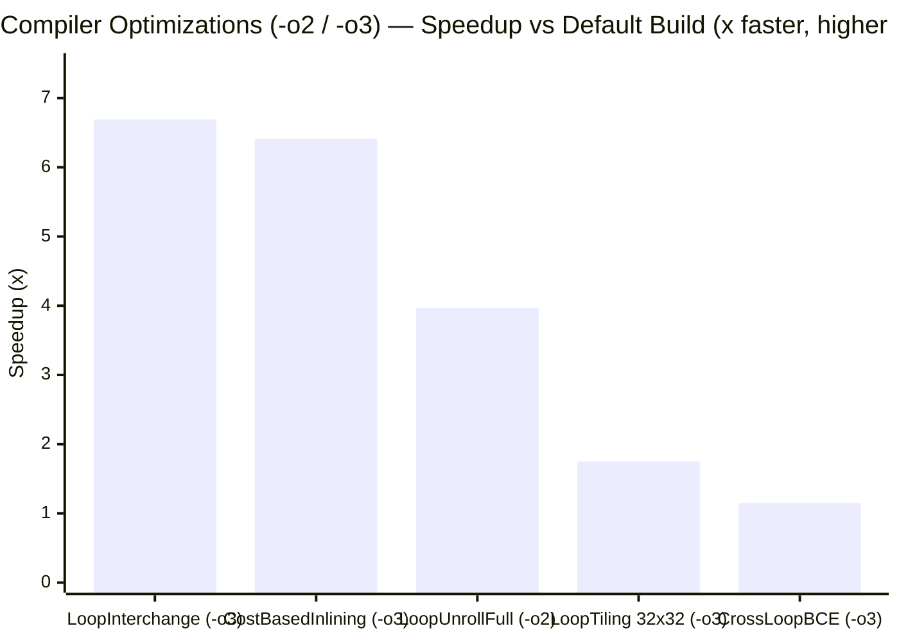
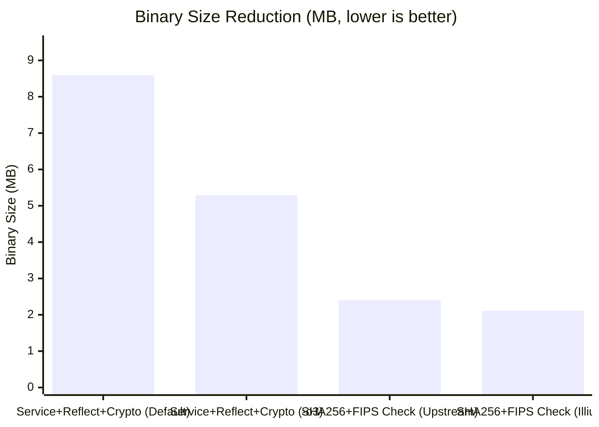

```mermaid
xychart-beta
    title "reflect: Upstream (left bar) vs Illium (right bar) — Latency (ns/op, lower is better)"
    x-axis ["Equal (Struct)", "Comparable", "AppendSlice", "DeepEqual ([]int)", "Call (Method)", "Call (Variadic)", "MapsDeepEqual", "Select (8)", "VisibleFields"]
    y-axis "Latency (ns/op)" 0 --> 750
    bar [54.53, 170.8, 60.58, 82.79, 250.1, 328.0, 340.9, 371.6, 727.3]
    bar [6.28, 16.36, 29.37, 31.70, 184.9, 229.8, 141.6, 314.4, 223.2]
```

# The Go Programming Language Illium

Go is an open source programming language that makes it easy to build simple,
reliable, and efficient software.

This fork is a personal Go branch maintained by 404Setup.

## Features

> This fork does not modify language syntax or break existing standard library APIs.

### Standard Library & Runtime
- **`io`**: Tiered chunk pooling (`4 KiB`–`256 KiB` via `sync/v2.Pool`) and exact-sized `bytealg.MakeNoZero` final buffer allocation in `ReadAll` overflow paths.
- **`sync/v2`**: Generic `Pool[T]` and `Map[K, V]` (`HashTrieMap` with online `Shrink()`), with standard library internal usages migrated from `sync`.
- **`sync/v2/container`**: Generic map containers: `OrderedMap[K, V]`, `ConcurrentSkipListMap[K, V]`, `LinkedHashMap[K, V]`, and `TreeMap[K, V]`.
- **`sync/atomic/v2`**: Generic `Value[T]` avoiding interface boxing for scalar and pointer operations.
- **`net`**: Built-in TTL-aware DNS response cache (RFC 1035 / RFC 2308 negative caching, lock-free lookup, RFC 6724 route cache; disable with `GODEBUG=netdnscache=0`), DNS address shuffling before RFC 6724 sorting, and stack-buffered `(*TCPAddr).String` formatting for zone-less IPv4/IPv6 addresses.
- **`net/http`, `net/textproto`, `net/url`**: Reduced allocations, goroutine churn, and parsing/formatting overhead across HTTP/1.1 request/response header readers (`requestWithURL` combined allocation, `Host`-only and buffered two-pass `readMIMEHeaderBuffered` fast paths, header key/value interning, `CanonicalMIMEHeaderKey` common-key switch and ASCII validation, contiguous value buffer slicing), server connection and request lifecycle (`connWorkerPool` and `bgReadWorkerPool` with GC-driven pruning, on-demand `backgroundRead` for synchronous handlers, embedded `connReader` and `serverConnContext`, `responsePool`, flat-slice header snapshotting via `snapshotHeader`, atomic hijack and read/write deadline tracking, lazy connection/request context creation, direct `conn.bufw` write bypass), client `Transport` paths (`NoBody` write bypass, closure-free `setRequestCancel`/`bodyEOFSignal`, reusable `persistConn` channels, inline `addedGzip`/`addedClose` flags, ASCII `canonicalAddr` fast path, lock-closure removal in `poolGetConn`/`poolConnStateHook`), clean origin-form URL/query parsing (`scanCleanOriginURI`), cookies, status lines, and `ServeMux` routing.
- **`reflect`**: Allocation and throughput optimizations for `Equal`, `DeepEqual`, `Comparable`, `Value.Call`, `Select`, `Value.MapKeys` (chunked key copies), and struct field introspection.
- **`runtime`**: Synchronous unmarked span reclamation before heap growth (`reclaimBeforeGrow`), fused 64-bit word-wide zombie check and allocation counting during span sweep (`countAllocAndCheckZombies`), `TrailingZeros8`/`TrailingZeros32` bit scanning in `reclaimChunk`, `scanblock`, `markrootSpans`, and `typeBitsBulkBarrier`, `tp.nextFast` and `nil`-pointer filtering in bulk write barriers, consecutive pointer deduplication in `wbBufFlush1` and GreenTeaGC span/object scanners, empty `spanSet.reset` STW fast path, `workbuf`/`wbBuf` bounds checks, and zero-size fast paths in `makeslice`, `makeslicecopy`, `rawbyteslice`, and `rawruneslice`.
- **`cmd/compile`**: Tiered stack small-buffer optimization (SBO) for non-escaping dynamic `make` and `make+copy` (`128 B` pointerless / `64 B` pointer-bearing), inlining budget promotion for dynamic `make` helpers, and static constant propagation for `make` and `[]byte(s)`.
- **`crypto/fips140`**: Compile-time and link-time dead code elimination of FIPS 140 integrity checks and self-tests when `GOFIPS140=off`.
- **`cmd/go`**: Terminal progress indicator (`Building [====   ] x/y`) for `go build` and `go install`.

### Compiler & Linker Flags
- **`-ldflags="-o2"`**: Bounded loop unrolling and post-SCCP/prove dead branch elimination.
- **`-ldflags="-o3"`**: Includes `-o2`, plus cost-based inlining, 2D loop interchange and $32 \times 32$ tiling, dead finite loop removal, cross-loop bounds check elimination, wrapper tail calls, and two-stage reflection/interface linker dead code elimination.
- **`-ldflags="-fmth"`**: Fast-math SSA reductions, reciprocal division, FMA contraction, polynomial approximations for `math` transcendentals, and hardware `FTZ`/`DAZ` mode (may relax strict IEEE 754 semantics).

Use `all=` (e.g., `-ldflags="all=-o3"`) to apply flags across all dependencies.

---

## Benchmarks

All benchmarks below were executed on `linux/amd64` (Intel Xeon Platinum 8481C) comparing upstream Go against Illium.

### 1. `sync/v2`, `sync/v2/container`, and `sync/atomic/v2`

```mermaid
xychart-beta
    title "Concurrency Primitives: v1 (left bar) vs v2 (right bar) — Latency (ns/op, lower is better)"
    x-axis ["Map.Load (Hits)", "Map.Mixed", "Pool (Struct Val)", "atomic.Store (int)", "atomic.Swap (int)", "atomic.CAS Mismatch"]
    y-axis "Latency (ns/op)" 0 --> 75
    bar [12.14, 52.23, 25.90, 17.18, 18.31, 69.03]
    bar [7.11, 38.81, 6.23, 5.77, 7.55, 9.79]
```

| Benchmark | `v1` (`sync` / `atomic`) | `v2` (`sync/v2` / `atomic/v2`) | Latency Delta | Allocs (`v1` → `v2`) |
| :--- | ---: | ---: | ---: | :---: |
| `MapLoadFreshEmpty` | 2.43 ns/op | **2.05 ns/op** | **-15.6%** (1.19×) | 0 → 0 |
| `MapLoadMostlyHits` | 12.14 ns/op | **7.11 ns/op** | **-41.4%** (1.71×) | 0 → 0 |
| `MapMixed` | 52.23 ns/op | **38.81 ns/op** | **-25.7%** (1.35×) | 6 B → 4 B |
| `PoolPointer` | 6.52 ns/op | **6.79 ns/op** | ~0% (parity) | 0 → 0 |
| `PoolValue` (32B struct) | 25.90 ns/op | **6.23 ns/op** | **-76.0%** (4.16×) | 1 (32 B) → **0 (0 B)** |
| `atomic.Value Load (int)` | 1.03 ns/op | **0.35 ns/op** | **-66.0%** (2.94×) | 0 → 0 |
| `atomic.Value Load (ptr, parallel)` | 4.70 ns/op | **3.66 ns/op** | **-22.1%** (1.28×) | 0 → 0 |
| `atomic.Value Store (int)` | 17.18 ns/op | **5.77 ns/op** | **-66.4%** (2.98×) | 7 B → **0 B** |
| `atomic.Value Swap (int)` | 18.31 ns/op | **7.55 ns/op** | **-58.8%** (2.43×) | 7 B → **0 B** |
| `atomic.Value CAS Mismatch (Large)` | 69.03 ns/op | **9.79 ns/op** | **-85.8%** (7.05×) | 1 (128 B) → **0 (0 B)** |

```mermaid
xychart-beta
    title "sync/v2/container Ordered & Sorted Maps — Latency by Operation (ns/op, lower is better)"
    x-axis ["LinkedHashMap", "OrderedMap (Concurrent)", "TreeMap (Sorted)", "ConcurrentSkipListMap"]
    y-axis "Latency (ns/op)" 0 --> 330
    bar [10.79, 21.00, 53.28, 85.54]
    bar [11.88, 47.61, 51.49, 120.03]
    bar [66.99, 252.73, 281.83, 319.97]
```

> *Bars per container (left to right): **Load**, **Store**, and **Delete+Store Churn** across 1,024 entries (`OrderedMap` parallel hit load: **9.04 ns/op**, 0 allocs/op).*

---

### 2. `net/http`, `net/textproto`, and `net/url` Optimizations

```mermaid
xychart-beta
    title "net/http: Upstream (left bar) vs Illium (right bar) — Latency (ns/op, lower is better)"
    x-axis ["ReadRequest (Wrk)", "ServerMatch", "ReadRequest (Chrome)", "ReadMIMEHeader", "ServerKeepAliveLite", "ServerHandlerNoLen", "ServerHandlerTypeLen", "ServerKeepAlive"]
    y-axis "Latency (ns/op)" 0 --> 6600
    bar [989.1, 895.5, 2790, 2704, 3383, 4796, 5278, 6496]
    bar [231.7, 528.4, 1693, 1578, 801.0, 1172, 1303, 2495]
```

| Benchmark | Upstream Go | Illium | Latency Delta | Allocs (`Upstream` → `Illium`) |
| :--- | ---: | ---: | ---: | :---: |
| `StatusCodeString` (`internal`) | 21.29 ns/op | **0.33 ns/op** | **-98.4%** (64.52×) | 1 (3 B) → **0 (0 B)** |
| `DetectContentType/Binary512` (`internal`) | 263.0 ns/op | **6.55 ns/op** | **-97.5%** (40.15×) | 0 → 0 |
| `DetectContentType/PNG` (`internal`) | 146.7 ns/op | **3.89 ns/op** | **-97.4%** (37.71×) | 0 → 0 |
| `DetectContentType/MP4` (`internal`) | 186.9 ns/op | **7.13 ns/op** | **-96.2%** (26.21×) | 0 → 0 |
| `DetectContentType/HTML` (`internal`) | 14.54 ns/op | **5.44 ns/op** | **-62.5%** (2.67×) | 0 → 0 |
| `ParseHTTPDate/RFC850` (`internal`) | 431.8 ns/op | **26.02 ns/op** | **-94.0%** (16.59×) | 7 (307 B) → **0 (0 B)** |
| `ParseCookieDate` (`internal`) | 309.4 ns/op | **25.14 ns/op** | **-91.9%** (12.31×) | 4 (163 B) → **0 (0 B)** |
| `EncodeHeaders/Empty` (`http2`) | 33.64 ns/op | **2.55 ns/op** | **-92.4%** (13.19×) | 0 → 0 |
| `ReverseProxy.ServeHTTP` (`httputil`) | 9,173 ns/op | **791.0 ns/op** | **-91.4%** (11.60×) | 14 (34,256 B) → **10 (1,443 B)** |
| `StatusText` | 3.67 ns/op | **0.34 ns/op** | **-90.7%** (10.79×) | 0 → 0 |
| `ReverseProxyFlushInterval` (`httputil`, SSE) | 308.9 ns/op | **49.48 ns/op** | **-84.0%** (6.24×) | 2 (336 B) → **0 (0 B)** |
| `ResponseStatusLine404` | 15.93 ns/op | **3.23 ns/op** | **-79.7%** (4.93×) | 0 → 0 |
| `ReadRequest/Wrk` | 989.1 ns/op | **231.7 ns/op** | **-76.6%** (4.27×) | 7 (912 B) → **2 (496 B)** |
| `ChunkedWriter/BufioSmall` (`internal`) | 68.55 ns/op | **16.20 ns/op** | **-76.4%** (4.23×) | 0 → 0 |
| `ChunkedWriter/Unbuffered` (`internal`) | 67.94 ns/op | **21.71 ns/op** | **-68.0%** (3.13×) | 0 → 0 |
| `ServerFakeConnWithKeepAliveLite` | 3,383 ns/op | **801.0 ns/op** | **-76.3%** (4.22×) | 10 (1,248 B) → **2 (496 B)** |
| `AppendHTTPDate` (`internal`) | 130.4 ns/op | **31.47 ns/op** | **-75.9%** (4.14×) | 0 → 0 |
| `ServerHandlerNoLen` | 4,796 ns/op | **1,172 ns/op** | **-75.6%** (4.09×) | 16 (2,080 B) → **3 (512 B)** |
| `ServerHandlerNoType` | 4,888 ns/op | **1,200 ns/op** | **-75.5%** (4.07×) | 17 (2,080 B) → **4 (516 B)** |
| `ServerHandlerTypeLen` | 5,278 ns/op | **1,303 ns/op** | **-75.3%** (4.05×) | 19 (2,129 B) → **5 (532 B)** |
| `ServerHandlerNoHeader` | 3,398 ns/op | **863.8 ns/op** | **-74.6%** (3.93×) | 10 (1,248 B) → **2 (496 B)** |
| `HTTPDateNowString` (`internal`) | 220.4 ns/op | **61.20 ns/op** | **-72.2%** (3.60×) | 1 (32 B) → **0 (0 B)** |
| `ReadSetCookies` | 1,811 ns/op | **590.7 ns/op** | **-67.4%** (3.07×) | 21 (1,168 B) → **3 (400 B)** |
| `ParseSetCookie` | 1,081 ns/op | **361.7 ns/op** | **-66.5%** (2.99×) | 13 (640 B) → **1 (192 B)** |
| `ResponseWrite` | 682.5 ns/op | **238.1 ns/op** | **-65.1%** (2.87×) | 4 (201 B) → **0 (0 B)** |
| `ClientServerParallel/4/h1` | 18.40 µs/op | **6.57 µs/op** | **-64.3%** (2.80×) | 56 (7,120 B) → **21 (3,293 B)** |
| `ServerFakeConnWithKeepAlive` | 6,496 ns/op | **2,495 ns/op** | **-61.6%** (2.60×) | 21 (2,424 B) → **6 (1,216 B)** |
| `LowerHeader/Known` (`httpcommon`) | 11.04 ns/op | **4.50 ns/op** | **-59.3%** (2.45×) | 0 → 0 |
| `CanonicalHeader/Known` (`httpcommon`) | 8.86 ns/op | **5.39 ns/op** | **-39.1%** (1.64×) | 0 → 0 |
| `StreamWriteVarint` (`http3`) | 312.6 ns/op | **128.7 ns/op** | **-58.9%** (2.43×) | 0 (15 B) → 0 (15 B) |
| `ServerFakeConnNoKeepAlive` | 12,721 ns/op | **5,433 ns/op** | **-57.3%** (2.34×) | 46 (4,689 B) → **22 (3,016 B)** |
| `CookieString` | 431.4 ns/op | **195.5 ns/op** | **-54.7%** (2.21×) | 1 (176 B) → **1 (144 B)** |
| `ResponseRecorderResult` (`httptest`) | 401.0 ns/op | **194.6 ns/op** | **-51.5%** (2.06×) | 5 (232 B) → **3 (208 B)** |
| `HeaderWriteSubsetBuilder` | 458.6 ns/op | **257.0 ns/op** | **-44.0%** (1.78×) | 4 (240 B) → **1 (112 B)** |
| `ClientServer/h1` | 19.58 µs/op | **11.07 µs/op** | **-43.5%** (1.77×) | 61 (5,420 B) → **22 (3,097 B)** |
| `ServeMux` (end-to-end) | 45.24 µs/op | **25.95 µs/op** | **-42.6%** (1.74×) | 360 → 360 |
| `ReadMIMEHeader/client_headers` (`textproto`) | 2,704 ns/op | **1,578 ns/op** | **-41.6%** (1.71×) | 16 (1,552 B) → **7 (1,480 B)** |
| `ServerMatch` (`ServeMux`) | 895.5 ns/op | **528.4 ns/op** | **-41.0%** (1.69×) | 10 (791 B) → **5 (568 B)** |
| `ReadRequest/Chrome` | 2,790 ns/op | **1,693 ns/op** | **-39.3%** (1.65×) | 13 (1,512 B) → **5 (1,456 B)** |
| `ReadRequest/Siege` | 1,568 ns/op | **1,008 ns/op** | **-35.7%** (1.56×) | 10 (1,029 B) → **5 (976 B)** |
| `ReadRequest/Curl` | 1,156 ns/op | **756.9 ns/op** | **-34.5%** (1.53×) | 8 (944 B) → **5 (928 B)** |
| `ReadRequest/Apachebench` | 1,179 ns/op | **777.5 ns/op** | **-34.1%** (1.52×) | 8 (947 B) → **5 (920 B)** |
| `HeaderWriteSubsetBufio` | 294.3 ns/op | **204.1 ns/op** | **-30.7%** (1.44×) | 0 → 0 |
| `QPACKPrefixedString/EncoderHeaders` (`http3`) | 476.0 ns/op | **356.7 ns/op** | **-25.1%** (1.33×) | 7 (176 B) → **4 (184 B)** |
| `ServeMux_SkipServe` | 16.51 µs/op | **12.47 µs/op** | **-24.4%** (1.32×) | 0 → 0 |
| `ClientRequestHeaders/1000` (`http2`) | 1,114 µs/op | **893.8 µs/op** | **-19.8%** (1.25×) | 4,074 (324 KB) → **3,054 (230 KB)** |
| `ParseRange` | 267.7 ns/op | **219.1 ns/op** | **-18.2%** (1.22×) | 3 (112 B) → **1 (64 B)** |
| `ServeContent` | 3,016 ns/op | **2,585 ns/op** | **-14.3%** (1.17×) | 16 (5,244 B) → 16 (5,244 B) |

#### `valyala/fasthttp` Suite (`-cpu=2`)

| Benchmark | `fasthttp` | Upstream `net/http` | Illium `net/http` | Illium vs Upstream | Ratio (`net/http` / `fasthttp`) | Allocs (`Upstream` → `Illium`) |
| :--- | ---: | ---: | ---: | ---: | ---: | :---: |
| Server GET (`NumCPU` clients, 1 req/conn) | 1,936 ns/op | 6,547 ns/op | **3,734 ns/op** | **-43.0%** (1.75×) | **1.93×** (upstream 3.38×) | 34 (3,176 B) → **10 (1,408 B)** |
| Server GET (`NumCPU` clients, 2 req/conn) | 1,395 ns/op | 4,617 ns/op | **2,615 ns/op** | **-43.4%** (1.77×) | **1.87×** (upstream 3.31×) | 26 (2,720 B) → **8 (1,240 B)** |
| Server GET (`NumCPU` clients, 10 req/conn) | 658.9 ns/op | 3,125 ns/op | **1,675 ns/op** | **-46.4%** (1.87×) | **2.54×** (upstream 4.74×) | 21 (2,380 B) → **7 (1,118 B)** |
| Server GET (`NumCPU` clients, 10K req/conn) | 439.0 ns/op | 2,770 ns/op | **1,471 ns/op** | **-46.9%** (1.88×) | **3.35×** (upstream 6.31×) | 19 (2,280 B) → **7 (1,089 B)** |
| Server POST (`NumCPU` clients, 1 req/conn) | 2,124 ns/op | 6,850 ns/op | **4,356 ns/op** | **-36.4%** (1.57×) | **2.05×** (upstream 3.23×) | 40 (3,864 B) → **12 (2,064 B)** |
| Server POST (`NumCPU` clients, 2 req/conn) | 1,532 ns/op | 5,048 ns/op | **3,140 ns/op** | **-37.8%** (1.61×) | **2.05×** (upstream 3.30×) | 32 (3,408 B) → **10 (1,896 B)** |
| Server POST (`NumCPU` clients, 10 req/conn) | 719.8 ns/op | 3,702 ns/op | **2,307 ns/op** | **-37.7%** (1.60×) | **3.21×** (upstream 5.14×) | 27 (3,068 B) → **9 (1,774 B)** |
| Server POST (`NumCPU` clients, 10K req/conn) | 538.0 ns/op | 3,269 ns/op | **2,097 ns/op** | **-35.9%** (1.56×) | **3.90×** (upstream 6.08×) | 25 (2,969 B) → **9 (1,746 B)** |
| Server GET (10K clients, 1 req/conn) | 2,063 ns/op | 5,159 ns/op | **3,641 ns/op** | **-29.4%** (1.42×) | **1.76×** (upstream 2.50×) | 34 (3,186 B) → **10 (1,483 B)** |
| Server GET (10K clients, 2 req/conn) | 1,278 ns/op | 4,050 ns/op | **2,537 ns/op** | **-37.4%** (1.60×) | **1.99×** (upstream 3.17×) | 26 (2,729 B) → **8 (1,267 B)** |
| Server GET (10K clients, 10 req/conn) | 606.0 ns/op | 3,171 ns/op | **1,708 ns/op** | **-46.1%** (1.86×) | **2.82×** (upstream 5.23×) | 21 (2,389 B) → **7 (1,128 B)** |
| Server GET (10K clients, 100 req/conn) | 460.1 ns/op | 2,674 ns/op | **1,560 ns/op** | **-41.7%** (1.71×) | **3.39×** (upstream 5.81×) | 19 (2,298 B) → **7 (1,106 B)** |
| Client+Server E2E GET (TCP, p=1) | 9,272 ns/op | 21,399 ns/op | **15,675 ns/op** | **-26.7%** (1.37×) | **1.69×** (upstream 2.31×) | 70 (6,381 B) → **20 (2,913 B)** |
| Client+Server E2E GET (TCP, p=10) | 7,606 ns/op | 17,646 ns/op | **14,737 ns/op** | **-16.5%** (1.20×) | **1.94×** (upstream 2.32×) | 70 (6,393 B) → **20 (2,921 B)** |
| Client+Server E2E GET (TCP, p=100) | 7,548 ns/op | 19,177 ns/op | **14,373 ns/op** | **-25.1%** (1.33×) | **1.90×** (upstream 2.54×) | 70 (6,522 B) → **20 (3,034 B)** |
| Client+Server E2E GET (Inmemory, p=1) | 2,169 ns/op | 10,848 ns/op | **7,480 ns/op** | **-31.0%** (1.45×) | **3.45×** (upstream 5.00×) | 70 (6,313 B) → **21 (2,929 B)** |
| Client+Server E2E GET (Inmemory, p=10) | 2,597 ns/op | 11,733 ns/op | **7,458 ns/op** | **-36.4%** (1.57×) | **2.87×** (upstream 4.52×) | 69 (6,304 B) → **21 (2,933 B)** |
| Client+Server E2E GET (Inmemory, p=100) | 2,688 ns/op | 12,921 ns/op | **8,697 ns/op** | **-32.7%** (1.49×) | **3.24×** (upstream 4.81×) | 69 (6,405 B) → **21 (2,992 B)** |
| Client+Server E2E GET (Inmemory, p=1000) | 2,468 ns/op | 14,472 ns/op | **10,928 ns/op** | **-24.5%** (1.32×) | **4.43×** (upstream 5.86×) | 71 (7,150 B) → **23 (3,724 B)** |
| Client+Server E2E 1MB Body (Inmemory, p=1) | 455.4 µs/op | 782.9 µs/op | **315.2 µs/op** | **-59.7%** (2.48×) | **0.69×** (upstream 1.72×) | 103 (2.13 MiB) → **30 (1.00 MiB)** |
| Client+Server E2E 1MB Body (Inmemory, p=10) | 365.3 µs/op | 757.8 µs/op | **453.7 µs/op** | **-40.1%** (1.67×) | **1.24×** (upstream 2.07×) | 103 (2.14 MiB) → **31 (1.01 MiB)** |

---

### 3. `net` DNS Resolver Cache

```mermaid
xychart-beta
    title "net DNS Resolver: Uncached (left bar) vs Cached (right bar) — Latency (ns/op, lower is better)"
    x-axis ["LookupHost (Dual-Stack)", "LookupHost (Parallel)", "LookupTXT"]
    y-axis "Latency (ns/op)" 0 --> 46000
    bar [44548, 44548, 3612]
    bar [1436, 1279, 467.6]
```

| Benchmark | Uncached (`netdnscache=0`) | Cached (Default) | Latency Delta | Allocs (`Uncached` → `Cached`) |
| :--- | ---: | ---: | ---: | :---: |
| `DNSLookupHost` (A + AAAA + RFC 6724) | 44,548 ns/op | **1,436 ns/op** | **-96.8%** (31.02×) | 74 (10,136 B) → **10 (288 B)** |
| `DNSLookupHostParallel` | 44,548 ns/op | **1,279 ns/op** | **-97.1%** (34.83×) | 74 (10,136 B) → **10 (288 B)** |
| `DNSLookupTXT` | 3,612 ns/op | **467.6 ns/op** | **-87.1%** (7.72×) | 22 (4,216 B) → **5 (112 B)** |

---

### 4. `reflect` Optimizations

| Benchmark | Upstream Go | Illium | Latency Delta | Allocs (`Upstream` → `Illium`) |
| :--- | ---: | ---: | ---: | :---: |
| `Comparable` (struct) | 170.8 ns/op | **16.36 ns/op** | **-90.4%** (10.44×) | 7 (100 B) → **0 (0 B)** |
| `Equal/RegularMemory` | 54.53 ns/op | **6.28 ns/op** | **-88.5%** (8.68×) | 0 → 0 |
| `DeepEqual/[][6]uint8` | 144.7 ns/op | **35.81 ns/op** | **-75.3%** (4.04×) | 0 → 0 |
| `VisibleFields/Flat` | 727.3 ns/op | **223.2 ns/op** | **-69.3%** (3.26×) | 11 (1,080 B) → **2 (624 B)** |
| `DeepEqual/[]int` | 82.79 ns/op | **31.70 ns/op** | **-61.7%** (2.61×) | 0 → 0 |
| `MapsDeepEqual` | 340.9 ns/op | **141.6 ns/op** | **-58.5%** (2.41×) | 6 (48 B) → **0 (0 B)** |
| `AppendSlice` | 60.58 ns/op | **29.37 ns/op** | **-51.5%** (2.06×) | 2 (48 B) → **1 (24 B)** |
| `MapKeys/string/1024` | 39.76 µs/op | **24.68 µs/op** | **-37.9%** (1.61×) | 1,025 (43,648 B) → **5 (46,720 B)** |
| `MapKeys/int/64` | 2.349 µs/op | **1.500 µs/op** | **-36.2%** (1.57×) | 65 (2,304 B) → **2 (2,304 B)** |
| `Convert/CanConvert` | 9.40 ns/op | **6.20 ns/op** | **-34.0%** (1.52×) | 0 → 0 |
| `Convert/IntToString` | 56.74 ns/op | **38.64 ns/op** | **-31.9%** (1.47×) | 2 (20 B) → 2 (20 B) |
| `CallSerial/Variadic` | 328.0 ns/op | **229.8 ns/op** | **-29.9%** (1.43×) | 4 (80 B) → **3 (56 B)** |
| `CallSerial/Method` | 250.1 ns/op | **184.9 ns/op** | **-26.1%** (1.35×) | 3 (40 B) → **2 (32 B)** |
| `Select/8` | 371.6 ns/op | **314.4 ns/op** | **-15.4%** (1.18×) | 11 (512 B) → **4 (456 B)** |

---

### 5. Compiler & Linker Optimizations (`-o2`, `-o3`, `-fmth`, and `GOFIPS140`)

#### Loop, Inlining & Bounds Optimizations (`-o2` and `-o3`)

| Optimization Benchmark | Flag | Default Build | Optimized Build | Latency Delta / Speedup |
| :--- | :---: | ---: | ---: | ---: |
| `LoopInterchange` ($512 \times 512$ column-to-row) | `-o3` | 1,974 µs/op | **295.2 µs/op** | **-85.1%** (6.69× faster) |
| `CostBasedInlining` (specialization + devirt) | `-o3` | 163.8 ns/op | **25.57 ns/op** | **-84.4%** (6.41× faster) |
| `LoopUnrollFull` (8-trip fixed loop) | `-o2` | 6.31 ns/op | **1.59 ns/op** | **-74.8%** (3.97× faster) |
| `LoopTiling` ($512 \times 512$ transpose, $32 \times 32$ tiles) | `-o3` | 1,340 µs/op | **767.1 µs/op** | **-42.8%** (1.75× faster) |
| `CrossLoopBCE` (nested token scanner) | `-o3` | 83.93 ns/op | **72.71 ns/op** | **-13.4%** (1.15× faster) |

#### Floating-Point Optimizations (`-fmth`)

```mermaid
xychart-beta
    title "Fast-Math (-fmth): Default IEEE-754 (left bar) vs -fmth (right bar) — Latency (ns/op, lower is better)"
    x-axis ["math.Pow", "math.Log", "math.Cos", "math.Sin", "math.Exp", "ReciprocalDiv (3x)"]
    y-axis "Latency (ns/op)" 0 --> 46
    bar [43.17, 9.00, 9.10, 8.36, 7.49, 4.11]
    bar [17.04, 5.26, 8.08, 8.04, 6.79, 1.95]
```

| Floating-Point Benchmark | Default (IEEE 754) | `-ldflags="all=-fmth"` | Latency Delta / Speedup |
| :--- | ---: | ---: | ---: |
| `math.Pow` (`FastPow` approximation) | 43.17 ns/op | **17.04 ns/op** | **-60.5%** (2.53× faster) |
| `ReciprocalDiv` (`a/d + b/d + c/d`) | 4.11 ns/op | **1.95 ns/op** | **-52.6%** (2.11× faster) |
| `math.Log` (`FastLog` approximation) | 9.00 ns/op | **5.26 ns/op** | **-41.6%** (1.71× faster) |
| `math.Cos` (`FastCos` approximation) | 9.10 ns/op | **8.08 ns/op** | **-11.2%** (1.13× faster) |
| `math.Exp` (`FastExp` approximation) | 7.49 ns/op | **6.79 ns/op** | **-9.3%** (1.10× faster) |

#### Dead Code Elimination & Binary Size (`-o3` and `GOFIPS140=off`)

| Binary Target | Baseline Size | Optimized Size | Size Reduction | Details |
| :--- | ---: | ---: | ---: | :--- |
| Service + `reflect.MethodByName` + Crypto | 8.59 MB (Default) | **5.29 MB** (`-ldflags="all=-o3"`) | **-38.4%** | Prunes unused interface & static `MethodByName` targets (`DropTLS`, `DropCrypto`) |
| Large-scale Production Codebase (~300k LOC) | Baseline | `-ldflags="all=-o3"` | **-27.1%** | Two-level compiler + linker dead code elimination |
| Minimal `crypto/sha256` + `crypto/fips140` | 2.40 MB (Upstream) | **2.11 MB** (Illium default) | **-12.0%** | Eliminates `crypto/internal/fips140/check` CAST/integrity init when `GOFIPS140=off` |

---

### 6. Memory Allocation, GC & Stack SBO (`runtime` and `cmd/compile`)

#### Dynamic Slice Allocation & Stack SBO

```mermaid
xychart-beta
    title "Memory Allocation & Stack SBO: Upstream (left bar) vs Illium (right bar) — Latency (ns/op, lower is better)"
    x-axis ["make []byte (64B)", "make []byte (128B)", "make []int (16)", "make []*byte (8)", "make+copy (64B)", "make+copy (128B)", "[]byte(s) (48B)"]
    y-axis "Latency (ns/op)" 0 --> 42
    bar [20.59, 37.86, 38.06, 23.60, 23.27, 38.86, 22.53]
    bar [3.70, 3.71, 3.71, 1.84, 3.93, 4.29, 1.88]
```

| Benchmark | Upstream Go | Illium | Latency Delta | Allocs (`Upstream` → `Illium`) |
| :--- | ---: | ---: | ---: | :---: |
| `DynamicMakeSliceSBO_Ptr8` (`make([]*byte, n)`, 64 B) | 23.60 ns/op | **1.84 ns/op** | **-92.2%** (12.83×) | 1 (64 B) → **0 (0 B)** |
| `StaticStringVarToBytes48` (`[]byte(s)`, 48 B) | 22.53 ns/op | **1.88 ns/op** | **-91.7%** (11.98×) | 1 (48 B) → **0 (0 B)** |
| `DynamicMakeSliceSBO_Int16` (`make([]int, n)`, 128 B) | 38.06 ns/op | **3.71 ns/op** | **-90.3%** (10.26×) | 1 (128 B) → **0 (0 B)** |
| `DynamicMakeSliceSBO_Byte128` (`make([]byte, n)`, 128 B) | 37.86 ns/op | **3.71 ns/op** | **-90.2%** (10.20×) | 1 (128 B) → **0 (0 B)** |
| `DynamicMakeSliceCopySBO_Byte128` (`make`+`copy`, 128 B) | 38.86 ns/op | **4.29 ns/op** | **-89.0%** (9.06×) | 1 (128 B) → **0 (0 B)** |
| `DynamicMakeSliceCopySBO_Byte64` (`make`+`copy`, 64 B) | 23.27 ns/op | **3.93 ns/op** | **-83.1%** (5.92×) | 1 (64 B) → **0 (0 B)** |
| `DynamicMakeSliceSBO_Byte64` (`make([]byte, n)`, 64 B) | 20.59 ns/op | **3.70 ns/op** | **-82.0%** (5.56×) | 1 (64 B) → **0 (0 B)** |
| `MakeSliceCopyZeroDynamic` (`makeslicecopy`, `tolen=0`) | 8.75 ns/op | **5.47 ns/op** | **-37.5%** (1.60×) | 0 → 0 |
| `MakeSliceZeroDynamic` (`makeslice`, `cap=0`) | 7.49 ns/op | **5.19 ns/op** | **-30.7%** (1.44×) | 0 → 0 |
| `DynamicMakeInlinePromotion` (inlined helper + SBO, 96 B) | 186.2 ns/op | **165.9 ns/op** | **-10.9%** (1.12×) | 1 (96 B) → **0 (0 B)** |
| `SpanReclaimChurn` (32 KB span alloc + GC reclaim) | 4,886 ns/op | **4,511 ns/op** | **-7.7%** (1.08×) | 1 (32 KB) → 1 (32 KB) |

#### Garbage Collector, Write Barrier & Sweep (`runtime`)

```mermaid
xychart-beta
    title "GC & Runtime Primitives: Upstream (left bar) vs Illium (right bar) — Latency (ns/op, lower is better)"
    x-axis ["SpanSetReset (STW)", "WbBufFlush1 (Dedup)", "BulkBarrier (Sparse)", "SweepSmallObjects", "ScanBlock (Sparse)"]
    y-axis "Latency (ns/op)" 0 --> 3500
    bar [3424, 1708, 961.0, 562.9, 389.1]
    bar [468.7, 656.8, 543.1, 505.9, 217.0]
```

| Benchmark | Upstream Go | Illium | Latency Delta | Allocs (`Upstream` → `Illium`) |
| :--- | ---: | ---: | ---: | :---: |
| `GCSpanSetResetEmpty` (272 `mcentral` `spanSet.reset` in STW) | 3,424 ns/op | **468.7 ns/op** | **-86.3%** (7.31×) | 0 → 0 |
| `GCWbBufFlushDedup` (`wbBufFlush1`, 512 entries) | 1,708 ns/op | **656.8 ns/op** | **-61.5%** (2.60×) | 0 → 0 |
| `GCScanBlockSparse` (`scanblock`, 2 KB root/stack block) | 389.1 ns/op | **217.0 ns/op** | **-44.2%** (1.79×) | 0 → 0 |
| `GCBulkBarrierBitmapSparseNil` (`bulkBarrierBitmap`, 2 KB) | 961.0 ns/op | **543.1 ns/op** | **-43.5%** (1.77×) | 0 → 0 |
| `GCScanSharedPointers` (4,096-element graph `runtime.GC()`) | 303.6 µs/op | **271.7 µs/op** | **-10.5%** (1.12×) | 0 → 0 |
| `GCSweepSmallObjects` (32 B alloc + periodic GC sweep) | 562.9 ns/op | **505.9 ns/op** | **-10.1%** (1.11×) | 0 → 0 |

---

## Notes & Policy

None of the commits will be merged upstream because I cannot guarantee the quality of my code and I do not have time 
to wait for the PR queue.

Want to set it up in Actions? We'll be releasing an action soon so you can seamlessly migrate to our fork. Until then, 
you can check out the examples in my project, which are licensed under the MPL-2.0 license. Once released as a release, 
it will be licensed under the Apache-2.0 license.

Before reporting an issue, you should confirm whether the problem originated with us or our upstream. You should not report 
bugs caused by us to our upstream.

We use streaming version updates, meaning we merge whatever our upstream updates in the master branch. 
We do not maintain LTS versions.

## Download and Install

### Binary Distributions

Official binary distributions are available at https://github.com/404Setup/go/releases.

### Install From Source

If a binary distribution is not available for your combination of
operating system and architecture, visit
https://go.dev/doc/install/source
for source installation instructions.