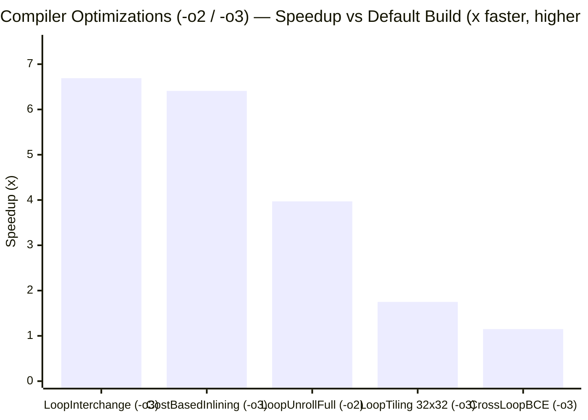
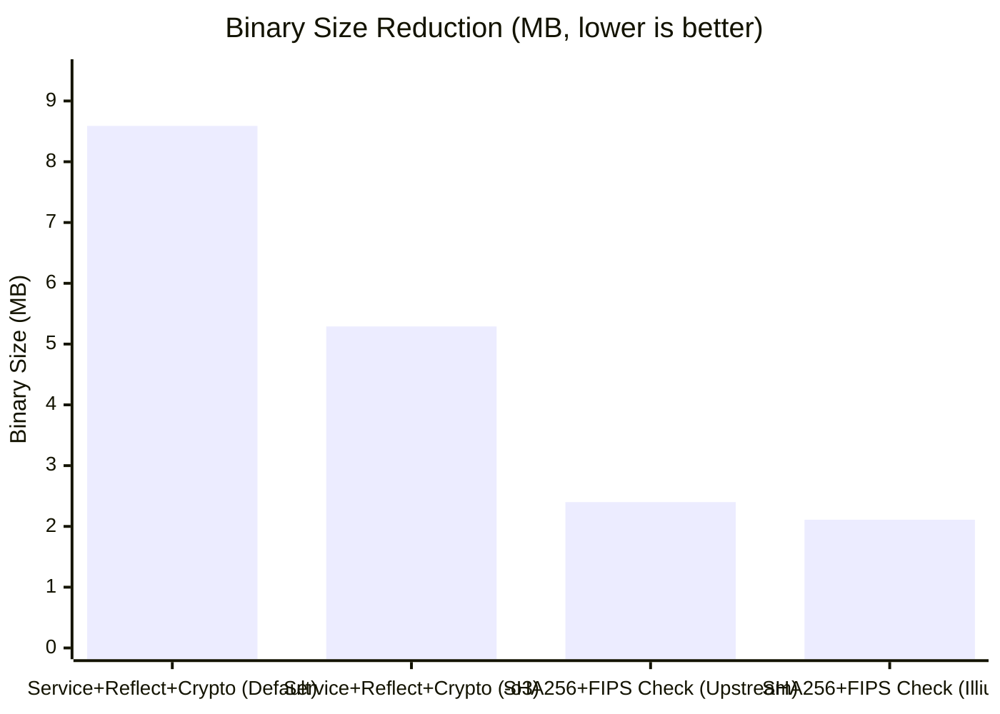

# The Go Programming Language Illium

Go is an open source programming language that makes it easy to build simple,
reliable, and efficient software.

This fork is a personal Go branch maintained by 404Setup.

## Features

> This fork will not release any updates that modify the language syntax or break existing APIs.

### Standard Library & Runtime
- **`std: sync/v2`**: Generic versions of `sync.Pool[T]` (including `GetOK()`) and `sync.Map[K, V]` (backed by `internal/sync.HashTrieMap` with online lock-free `Shrink()` and `abi.NoEscape` zero-allocation empty reads), along with type aliases and wrappers for `sync` primitives. Internal `sync.Pool` and `sync.Map` usages across the standard library (`archive/*`, `crypto/tls`, `encoding/*`, `fmt`, `go/printer`, `internal/poll`, `io`, `log/*`, `math/big`, `net/http`, `os`, `regexp`, `syscall`) are migrated to `sync/v2`.
- **`std: sync/v2/container`**: Generic ordered and sorted map containers:
  - `OrderedMap[K, V]`: Concurrent insertion-ordered map with batch-allocated entries and online `Shrink()`.
  - `ConcurrentSkipListMap[K, V]`: Concurrent sorted skip-list map with lock-free reads/iteration and inline level towers.
  - `LinkedHashMap[K, V]`: Insertion-ordered or LRU access-ordered map using a typed intrusive doubly-linked list and free-node cache.
  - `TreeMap[K, V]`: Sorted red-black tree map with iterative insertion, single-pass deletion, and stack-allocated iterators.
- **`std: sync/atomic/v2`**: Generic `atomic.Value[T]` eliminating interface boxing for scalar and pointer loads, stores, swaps, and compare-and-swaps.
- **`runtime / gc`**: Zero-allocation inline `poolCleanupHooks` registration in the garbage collector supporting both `sync` and `sync/v2` pools simultaneously, paired with typed `poolDequeue[T]` ring buffers in `sync/v2.Pool`.
- **`std: net/http`**: CPU and allocation optimizations across common HTTP/1.x and routing paths:
  - **Cookies**: Single-pass `Cookie.String` serialization with bounded buffer growth; zero-split `ParseSetCookie` with `ascii.EqualFold` matching; contiguous slice batch allocation in `ParseCookie` and `readCookies` (reducing per-header allocations from $N+1$ to 2).
  - **Status Lines**: $O(1)$ offset-table lookup in `StatusText` and precomputed HTTP/1.0 & HTTP/1.1 status lines in `writeStatusLine`.
  - **`ServeMux` & Routing Tree**: Virtual trailing-slash matching (`matchTrailingSlash`) directly in the routing tree without heap-allocating `path + "/"` strings, plus a SIMD fast path in `isCleanPath`.
  - **Headers, Forms & Lifecycle**: Consolidated backing slice allocation in `copyValues`, zero-allocation empty `Header.Clone`, and fast paths in `shouldClose` and `determineBodyLength`.
- **`std: reflect`**: Performance and allocation optimizations across common reflection operations:
  - **`DeepEqual`, `Equal` & `Comparable`**: `mayCycle` acyclic type bypass, inline 8-slot `visitSet` stack tracker, `bytealg.Equal` fast path for regular-memory types, in-place map comparison without `Value` copies, and devirtualized `Comparable` / `IsZero` inspection on `*abi.Type`.
  - **Invocation & `Select`**: Stack-allocated method receiver cells in `callMethod`, stack-allocated variadic slice headers in `Value.Call`, direct-mapped function layout cache in front of `layoutCache`, and shared receive buffers across identical element types in `Select`.
  - **Introspection, Slices & Iteration**: `visibleFieldsFlat` fast path for structs without embedded fields, direct memory copy in `Append` and `AppendSlice`, direct `unsafe_New` allocation in `makeString`/`makeBytes`/`makeRunes`, specialized `Swapper` paths, and static integer caching in `Seq`/`Seq2`.
- **`std: net`**: Shuffles resolved DNS IP addresses before RFC 6724 sorting in `Resolver.lookupIPAddr` to improve connection load-balancing across equal-precedence records.
- **`cmd/go`**: Interactive terminal build progress indicator (`Building [====   ] x/y`) during `go build` and `go install`.

### Compiler & Linker Optimizations
- **`compiler / runtime (-fmth)`**: Aggressive floating-point optimizations assuming finite operands/results and unsigned zero:
  - SSA algebraic reductions, reassociation, reciprocal multiplication (`x / d` sharing), `Sqrt` pairing, and FMA contraction.
  - Fast polynomial approximations for direct calls to `math.Exp`, `Exp2`, `Log`, `Log2`, `Log10`, `Pow`, `Sin`, `Cos`, and `Tan`.
  - Link-time activation of hardware Flush-to-Zero / Denormals-Are-Zero (`FTZ`/`DAZ` on x86 SSE2, `FPCR.FZ` on arm64) across runtime threads while preserving caller FP state across cgo transitions.
- **`compiler (-o2)`**:
  - Bounded loop unrolling (`o2 loop unroll`): Full unrolling for small constant-trip straight-line loops and $2\times$/$4\times$ partial unrolling within a code-size budget.
  - Late dead code elimination (`o2 deadcode`): Prunes unreachable branches exposed after Sparse Conditional Constant Propagation (`sccp`) and `prove`.
- **`compiler / linker (-o3)`**: Includes all `-o2` optimizations plus:
  - **Cost-Based Inlining**: Expanded inlining budget with callsite scoring that credits loop execution, constant argument specialization, and interface/closure devirtualization while penalizing cold/panic/init paths.
  - **Loop Interchange & Tiling**: Interchanges nested loops over 2D arrays for contiguous row-major memory access and tiles mixed row/column accesses (such as matrix transposes) into $32 \times 32$ blocks.
  - **Dead Finite Loop & Cross-Loop Bounds Elimination**: Removes provably terminating side-effect-free loops (`o3 deadcode`) and propagates non-negative induction variables across nested loops to eliminate redundant bounds checks (`loopbce`).
  - **Wrapper Tail Calls**: Emits tail calls for eligible pointer-shaped value-receiver method wrappers.
  - **Two-Stage Linker & Reflection Dead Code Elimination**: Resolves statically known `reflect.Value.MethodByName` and `reflect.Type.MethodByName` names through local aliases and prunes unreachable interface and reflection methods at link time (`deadcode_o3`), reducing binary size by up to 27.1%–38.4%.
- **`crypto/fips140`**: True compile-time and link-time dead code elimination of `crypto/internal/fips140` integrity checks and CAST self-tests when `GOFIPS140` is disabled (`GOFIPS140=off`).

The compiler and linker optimizations above can be enabled via `-ldflags` (use `all=` to apply to dependencies as well):
- `-ldflags="-o2"` (or `-ldflags="all=-o2"`)
- `-ldflags="-o3"` (or `-ldflags="all=-o3"`)
- `-ldflags="-fmth"` (or `-ldflags="all=-fmth"`) — *May violate strict IEEE 754 floating-point semantics; use with caution.*

---

## Benchmarks

All benchmarks below were executed on `linux/amd64` (Intel Xeon Platinum 8481C) comparing upstream Go against Illium.

### 1. `sync/v2`, `sync/v2/container`, and `sync/atomic/v2`

```mermaid
xychart-beta
    title "Concurrency Primitives: v1 (left bar) vs v2 (right bar) — Latency (ns/op, lower is better)"
    x-axis ["Map.Load (Hits)", "Map.Mixed", "Pool (Struct Val)", "atomic.Store (int)", "atomic.Swap (int)", "atomic.CAS Mismatch"]
    y-axis "Latency (ns/op)" 0 --> 75
    bar [12.14, 52.23, 25.90, 17.18, 18.31, 69.03]
    bar [7.11, 38.81, 6.23, 5.77, 7.55, 9.79]
```

| Benchmark | `v1` (`sync` / `atomic`) | `v2` (`sync/v2` / `atomic/v2`) | Latency Delta | Allocs (`v1` → `v2`) |
| :--- | ---: | ---: | ---: | :---: |
| `MapLoadFreshEmpty` | 2.43 ns/op | **2.05 ns/op** | **-15.6%** (1.19×) | 0 → 0 |
| `MapLoadMostlyHits` | 12.14 ns/op | **7.11 ns/op** | **-41.4%** (1.71×) | 0 → 0 |
| `MapMixed` | 52.23 ns/op | **38.81 ns/op** | **-25.7%** (1.35×) | 6 B → 4 B |
| `PoolPointer` | 6.52 ns/op | **6.79 ns/op** | ~0% (parity) | 0 → 0 |
| `PoolValue` (32B struct) | 25.90 ns/op | **6.23 ns/op** | **-76.0%** (4.16×) | 1 (32 B) → **0 (0 B)** |
| `atomic.Value Load (int)` | 1.03 ns/op | **0.35 ns/op** | **-66.0%** (2.94×) | 0 → 0 |
| `atomic.Value Load (ptr, parallel)` | 4.70 ns/op | **3.66 ns/op** | **-22.1%** (1.28×) | 0 → 0 |
| `atomic.Value Store (int)` | 17.18 ns/op | **5.77 ns/op** | **-66.4%** (2.98×) | 7 B → **0 B** |
| `atomic.Value Swap (int)` | 18.31 ns/op | **7.55 ns/op** | **-58.8%** (2.43×) | 7 B → **0 B** |
| `atomic.Value CAS Mismatch (Large)` | 69.03 ns/op | **9.79 ns/op** | **-85.8%** (7.05×) | 1 (128 B) → **0 (0 B)** |

```mermaid
xychart-beta
    title "sync/v2/container Ordered & Sorted Maps — Latency by Operation (ns/op, lower is better)"
    x-axis ["LinkedHashMap", "OrderedMap (Concurrent)", "TreeMap (Sorted)", "ConcurrentSkipListMap"]
    y-axis "Latency (ns/op)" 0 --> 330
    bar [10.79, 21.00, 53.28, 85.54]
    bar [11.88, 47.61, 51.49, 120.03]
    bar [66.99, 252.73, 281.83, 319.97]
```

> *Bars per container (left to right): **Load**, **Store**, and **Delete+Store Churn** across 1,024 entries (`OrderedMap` parallel hit load: **9.04 ns/op**, 0 allocs/op).*

---

### 2. `net/http` Optimizations

```mermaid
xychart-beta
    title "net/http: Upstream (left bar) vs Illium (right bar) — Latency (ns/op, lower is better)"
    x-axis ["CookieString", "CopyValues", "ServerMatch (Mux)", "ReadRequest (Wrk)", "ReadRequest (Curl)", "ReadSetCookies"]
    y-axis "Latency (ns/op)" 0 --> 2000
    bar [419.2, 756.5, 921.3, 919.2, 1239.7, 1864.3]
    bar [360.9, 856.0, 618.1, 785.5, 1069.3, 1412.7]
```

| Benchmark | Upstream Go | Illium | Latency Delta | Allocs (`Upstream` → `Illium`) |
| :--- | ---: | ---: | ---: | :---: |
| `StatusText` | 3.41 ns/op | **0.35 ns/op** | **-89.7%** (9.74×) | 0 → 0 |
| `ResponseStatusLine404` | 14.83 ns/op | **3.56 ns/op** | **-76.0%** (4.17×) | 0 → 0 |
| `CookieString` | 419.2 ns/op | **360.9 ns/op** | **-13.9%** (1.16×) | 1 (176 B) → **1 (144 B)** |
| `ReadSetCookies` | 1,864 ns/op | **1,413 ns/op** | **-24.2%** (1.32×) | 21 (1,168 B) → **11 (726 B)** |
| `ReadCookies/ParseCookie` | 2,254 ns/op | **2,234 ns/op** | **-0.9%** | 11 (2,000 B) → **2 (2,128 B)** (-81.8% allocs) |
| `CopyValues` | 756.5 ns/op | **856.0 ns/op** | +13.1% | 11 (736 B) → **6 (784 B)** (-45.5% allocs) |
| `ServerMatch` (`ServeMux`) | 921.3 ns/op | **618.1 ns/op** | **-32.9%** (1.49×) | 10 (791 B) → **5 (568 B)** (-50.0% allocs) |
| `ServeMux` (end-to-end) | 43.03 µs/op | **32.82 µs/op** | **-23.7%** (1.31×) | 360 → 360 |
| `ReadRequest/Wrk` | 919.2 ns/op | **785.5 ns/op** | **-14.5%** (1.17×) | 7 (912 B) → **6 (896 B)** |
| `ReadRequest/Curl` | 1,240 ns/op | **1,069 ns/op** | **-13.8%** (1.16×) | 9 (960 B) → **8 (944 B)** |
| `ServerFakeConn/KeepAliveLite` | 3,929 ns/op | **3,505 ns/op** | **-10.8%** (1.12×) | 12 (1,312 B) → **10 (1,248 B)** |

---

### 3. `reflect` Optimizations

```mermaid
xychart-beta
    title "reflect: Upstream (left bar) vs Illium (right bar) — Latency (ns/op, lower is better)"
    x-axis ["Equal (Struct)", "Comparable", "AppendSlice", "DeepEqual ([]int)", "Call (Method)", "Call (Variadic)", "MapsDeepEqual", "Select (8)", "VisibleFields"]
    y-axis "Latency (ns/op)" 0 --> 750
    bar [54.53, 170.8, 60.58, 82.79, 250.1, 328.0, 340.9, 371.6, 727.3]
    bar [6.28, 16.36, 29.37, 31.70, 184.9, 229.8, 141.6, 314.4, 223.2]
```

| Benchmark | Upstream Go | Illium | Latency Delta | Allocs (`Upstream` → `Illium`) |
| :--- | ---: | ---: | ---: | :---: |
| `Comparable` (struct) | 170.8 ns/op | **16.36 ns/op** | **-90.4%** (10.44×) | 7 (100 B) → **0 (0 B)** |
| `Equal/RegularMemory` | 54.53 ns/op | **6.28 ns/op** | **-88.5%** (8.68×) | 0 → 0 |
| `DeepEqual/[][6]uint8` | 144.7 ns/op | **35.81 ns/op** | **-75.3%** (4.04×) | 0 → 0 |
| `VisibleFields/Flat` | 727.3 ns/op | **223.2 ns/op** | **-69.3%** (3.26×) | 11 (1,080 B) → **2 (624 B)** |
| `DeepEqual/[]int` | 82.79 ns/op | **31.70 ns/op** | **-61.7%** (2.61×) | 0 → 0 |
| `MapsDeepEqual` | 340.9 ns/op | **141.6 ns/op** | **-58.5%** (2.41×) | 6 (48 B) → **0 (0 B)** |
| `AppendSlice` | 60.58 ns/op | **29.37 ns/op** | **-51.5%** (2.06×) | 2 (48 B) → **1 (24 B)** |
| `Convert/CanConvert` | 9.40 ns/op | **6.20 ns/op** | **-34.0%** (1.52×) | 0 → 0 |
| `Convert/IntToString` | 56.74 ns/op | **38.64 ns/op** | **-31.9%** (1.47×) | 2 (20 B) → 2 (20 B) |
| `CallSerial/Variadic` | 328.0 ns/op | **229.8 ns/op** | **-29.9%** (1.43×) | 4 (80 B) → **3 (56 B)** |
| `CallSerial/Method` | 250.1 ns/op | **184.9 ns/op** | **-26.1%** (1.35×) | 3 (40 B) → **2 (32 B)** |
| `Select/8` | 371.6 ns/op | **314.4 ns/op** | **-15.4%** (1.18×) | 11 (512 B) → **4 (456 B)** |

---

### 4. Compiler & Linker Optimizations (`-o2`, `-o3`, `-fmth`, and `GOFIPS140`)

#### Loop, Inlining & Bounds Optimizations (`-o2` and `-o3`)

| Optimization Benchmark | Flag | Default Build | Optimized Build | Latency Delta / Speedup |
| :--- | :---: | ---: | ---: | ---: |
| `LoopInterchange` ($512 \times 512$ column-to-row) | `-o3` | 1,974 µs/op | **295.2 µs/op** | **-85.1%** (6.69× faster) |
| `CostBasedInlining` (specialization + devirt) | `-o3` | 163.8 ns/op | **25.57 ns/op** | **-84.4%** (6.41× faster) |
| `LoopUnrollFull` (8-trip fixed loop) | `-o2` | 6.31 ns/op | **1.59 ns/op** | **-74.8%** (3.97× faster) |
| `LoopTiling` ($512 \times 512$ transpose, $32 \times 32$ tiles) | `-o3` | 1,340 µs/op | **767.1 µs/op** | **-42.8%** (1.75× faster) |
| `CrossLoopBCE` (nested token scanner) | `-o3` | 83.93 ns/op | **72.71 ns/op** | **-13.4%** (1.15× faster) |

#### Floating-Point Optimizations (`-fmth`)

```mermaid
xychart-beta
    title "Fast-Math (-fmth): Default IEEE-754 (left bar) vs -fmth (right bar) — Latency (ns/op, lower is better)"
    x-axis ["math.Pow", "math.Log", "math.Cos", "math.Sin", "math.Exp", "ReciprocalDiv (3x)"]
    y-axis "Latency (ns/op)" 0 --> 46
    bar [43.17, 9.00, 9.10, 8.36, 7.49, 4.11]
    bar [17.04, 5.26, 8.08, 8.04, 6.79, 1.95]
```

| Floating-Point Benchmark | Default (IEEE 754) | `-ldflags="all=-fmth"` | Latency Delta / Speedup |
| :--- | ---: | ---: | ---: |
| `math.Pow` (`FastPow` approximation) | 43.17 ns/op | **17.04 ns/op** | **-60.5%** (2.53× faster) |
| `ReciprocalDiv` (`a/d + b/d + c/d`) | 4.11 ns/op | **1.95 ns/op** | **-52.6%** (2.11× faster) |
| `math.Log` (`FastLog` approximation) | 9.00 ns/op | **5.26 ns/op** | **-41.6%** (1.71× faster) |
| `math.Cos` (`FastCos` approximation) | 9.10 ns/op | **8.08 ns/op** | **-11.2%** (1.13× faster) |
| `math.Exp` (`FastExp` approximation) | 7.49 ns/op | **6.79 ns/op** | **-9.3%** (1.10× faster) |

#### Dead Code Elimination & Binary Size (`-o3` and `GOFIPS140=off`)

| Binary Target | Baseline Size | Optimized Size | Size Reduction | Details |
| :--- | ---: | ---: | ---: | :--- |
| Service + `reflect.MethodByName` + Crypto | 8.59 MB (Default) | **5.29 MB** (`-ldflags="all=-o3"`) | **-38.4%** | Prunes unused interface & static `MethodByName` targets (`DropTLS`, `DropCrypto`) |
| Large-scale Production Codebase (~300k LOC) | Baseline | `-ldflags="all=-o3"` | **-27.1%** | Two-level compiler + linker dead code elimination |
| Minimal `crypto/sha256` + `crypto/fips140` | 2.40 MB (Upstream) | **2.11 MB** (Illium default) | **-12.0%** | Eliminates `crypto/internal/fips140/check` CAST/integrity init when `GOFIPS140=off` |

---

## Notes & Policy

None of the commits will be merged upstream because I cannot guarantee the quality of my code and I do not have time 
to wait for the PR queue.

Want to set it up in Actions? We'll be releasing an action soon so you can seamlessly migrate to our fork. Until then, 
you can check out the examples in my project, which are licensed under the MPL-2.0 license. Once released as a release, 
it will be licensed under the Apache-2.0 license.

Before reporting an issue, you should confirm whether the problem originated with us or our upstream. You should not report 
bugs caused by us to our upstream.

We use streaming version updates, meaning we merge whatever our upstream updates in the master branch. 
We do not maintain LTS versions.

## Download and Install

### Binary Distributions

Official binary distributions are available at https://github.com/404Setup/go/releases.

### Install From Source

If a binary distribution is not available for your combination of
operating system and architecture, visit
https://go.dev/doc/install/source
for source installation instructions.